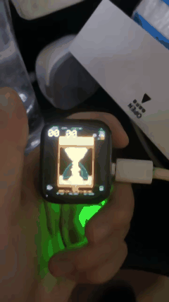
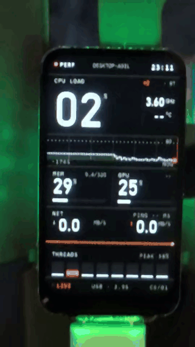

# LVGL Verify Loop

[](https://github.com/ZEQUAN-LIANG/lvgl-for-ai/releases)
[](LICENSE)
[](console/README.md)
[](scripts/meta/versions.json)

English | [简体中文](README.zh-CN.md)

A headless LVGL runtime that runs your UI, drives it with virtual input and records every frame. AI writes the LVGL C, looks at what actually happened, and checks it against the acceptance criteria you set. Ships as a Claude Code skill.

| You | AI |
| --- | --- |
| Give intent and reference visuals | Write the LVGL C code |
| Circle problems on the screen (annotations, whiteboards) | Run scenarios; read frames, timeline, diffs and logs |
| Set the acceptance criteria | Self-check, self-accept, then fix |

The tool never prints pass/fail. Acceptance criteria come from you.

## Highlights

- **Real LVGL, no display needed.** Six versions (9.6 / 9.5 / 9.4 / 9.1 / 8.4 / 8.3) in one headless host.
- **Virtual input and virtual time.** Clicks, drags, keys, encoder and a deterministic clock — no wall-clock flakiness.
- **Every run leaves replayable evidence.** PNG frames (changed frames only), timeline, per-frame diff bboxes, and the engine log.
- **A web inspector** at `127.0.0.1:8765`: live preview, session replay, and annotation/whiteboard tools for marking up problems on the actual screen.
- **No object tree, no `inspect`, no `set`.** Exact internal state is `printf`'d to `engine.log` by your C code and becomes evidence like everything else.
- **Ships as a skill.** One zip carries prebuilt LVGL libraries and engines for all six versions; running them needs only Python 3.9+.

## Install

Download a 0.2.2 bundle from [GitHub Releases](https://github.com/ZEQUAN-LIANG/lvgl-for-ai/releases) or [Gitee Releases](https://gitee.com/liang-zequan/lvgl-for-ai/releases):

- `lvgl-verify-loop-0.2.2-full-win64.zip` — all six LVGL versions and the viewer.
- `lvgl-verify-loop-0.2.2-full-sifli-win64.zip` — the same bundle plus the SiFli tools.

Extract it as a personal Claude Code skill (Windows PowerShell):

```powershell
Expand-Archive .\lvgl-verify-loop-0.2.2-full-win64.zip "$env:USERPROFILE\.claude\skills"
```

The zip has a single top-level `lvgl-verify-loop\` folder, so this creates `%USERPROFILE%\.claude\skills\lvgl-verify-loop\SKILL.md`. For one project only, extract into that project's `.claude\skills\` instead. Right-click → **Extract All** works too.

Restart Claude Code and run `/lvgl-verify-loop`, or just describe the LVGL UI you want.

Without an AI, double-click `bin\LVGL-AI-Viewer.exe` in the extracted folder (or run `bin\lvgl.cmd serve`) to open the inspector.

Working in the folder directly — the skill's commands are relative to the package root:

```bat
cd "%USERPROFILE%\.claude\skills\lvgl-verify-loop"
bin\lvgl.cmd run --scenario user\scenarios\intro.json --json
```

Python 3.9+ must be on PATH (`python`/`pythonw`, or `py`/`pyw`); the bundle does not ship a runtime. Running the bundled apps needs no CMake or GCC. Rebuilding after the AI edits C needs GCC 15.2.0 (MinGW-w64 64-bit), matching the compiler recorded in the bundled LVGL libraries.

## The loop

AI edits `user/app/**/*.c` directly, then builds and plays a scenario with one command:

```bash
python -I console/entrypoints/cli.py --lvgl 9.6 --scenario user/scenarios/settings.json --json
```

stdout is a single line of JSON pointing at the session:

```json
{"session_id": "20261121-181409-3dc9", "status": "ok", "display": {"width": 800, "height": 600}, "frame_count": 6, "effective_app": "test_ui", "lvgl": "9.6.0", "counts": {"clicks": 1, "drags": 1, "marks": 1, "snapshots": 2}, "truncated": false, "error": null}
```

AI reads the evidence against your criteria and decides whether to change anything. Because the run is deterministic and the frames are on disk, the same conclusion can be re-checked later by a human.

## Reading the evidence

A session is the `user/sessions/<id>/` directory:

```text
user/sessions/<id>/
  manifest.json          # status, app, resolution, frame count
  timeline.ndjson        # input events, frame spans, marks
  frame_diffs.ndjson     # per-frame changed bboxes
  frames/                # full PNGs; only frames with visual changes
  snapshots/             # named snapshots
  engine.log             # runtime log; exact state is printf'd here by C code
  build.log              # actual build commands and compiler output
  annotations.json       # human annotations (optional)
  whiteboards.json       # human whiteboards (optional; images in whiteboards/)
```

`status: ok` means the session ended normally — not that the UI is correct. Whether it meets the acceptance criteria is decided by humans.

Three things line up, and that is what makes a fix targeted rather than guessed:

- **Annotations and whiteboards** — frame numbers, bboxes, ranges, text and labels in `annotations.json` and `whiteboards.json`. Whiteboards support single-frame, time-range and global scopes, and always require text or labels, so images and words reach AI together.
- **Your code** — `user/app/**/*.c` is the only source of truth; widget creation, `lv_obj_add_event_cb` bindings and state live in C.
- **The run trace** — `timeline.ndjson` records the object name and class each input hit (`hit` / `hit_class`), and `frame_diffs.ndjson` records changed bboxes.

So AI can tell which code created a widget, which callback an event is bound to, who was hit, and which area changed afterwards.

## Multi-version verification

User apps are written against the LVGL 9.4 baseline and run on **9.6 / 9.5 / 9.4**, selected with `--lvgl <version>`. The same `user/app/**/*.c` and the same scenario drive all three. Cross-version comparison covers event semantics and the set of session files, not pixels.

**9.1 / 8.4 / 8.3** run through the same engine and evidence pipeline as a legacy check, but directory-based app discovery is gated to 9.4+, so those versions render an empty screen — useful for event-semantics checks, not for previewing an app.

## Real hardware

Two boards are wired today.

### SiFli SF32LB52x (Huangshan Pai)

Device apps are written against the LVGL 9.4 baseline; export copies app sources and only checks compatibility — it rejects 9.5/9.6-only APIs rather than rewriting them.

```bash
python -I chip-adapt/sifli/export.py sift_watch --dry-run
python -I chip-adapt/sifli/host/cli.py build --app sift_watch --actor ai --json
python -I chip-adapt/sifli/host/cli.py flash --app sift_watch --actor ai --json
```

The board's screen is 390×450; apps built for other sizes need layout adjustments. Without a board you can only stop at host verification and an export dry-run — never claim the device is verified.

<p align="center"></p>

### ESP32-C6-LCD-1.47

`perf_monitor` runs on a Waveshare ESP32-C6-LCD-1.47 (172×320 ST7789) through the Arduino bring-up path, with serial portrait/landscape switching, a host control page at `/perf/`, and a tkinter desktop panel. Monitoring defaults to 0.3 s, and the exporter/compiler paths are incremental:

```bash
python -I chip-adapt/esp32/arduino/build.py build
python -I chip-adapt/esp32/arduino/build.py flash --port COMx
python -I chip-adapt/esp32/host/host.py serve --port COMx --baud 115200 --open
python -I chip-adapt/esp32/host/perf/perf_gui.py
```

Verified on hardware: USB Serial/JTAG, esptool flashing, and a `SHOT` framebuffer dump. A formal ESP-IDF exporter is still on the roadmap.

<p align="center"></p>

## From source

```bash
git clone https://gitee.com/liang-zequan/lvgl-for-ai.git lvgl-for-agent
cd lvgl-for-agent

# 1. Download and install LVGL 9.6 sources
python -I scripts/fetch_lvgl.py --version 9.6 --repo-root .

# 2. Download PNG encoder sources (zlib / libpng)
python -I scripts/fetch_png.py --repo-root .

# 3. Run a scenario (the first run builds the engine; usually takes a few minutes)
python -I console/entrypoints/cli.py --lvgl 9.6 --scenario user/scenarios/settings.json

# 4. Open the web inspector
python -I console/entrypoints/serve.py --open
```

On success the exit code is `0`, the last stdout line is the session directory, and `manifest.json` has `status: ok`. The default `--source auto` tries GitHub codeload first and the Gitee mirror second; the Gitee LVGL mirror can return HTML/400, so use the default or a version pack when that happens.

Working from source? Open this repository in Claude Code; `CLAUDE.md` covers the repo workflow and `docs/skill/SKILL.md` is the skill entry. No separate skill install is needed.

Prebuilt LVGL libraries let you run with just GCC installed (`--prebuilt`). The tools are independent of harnesses like Claude Code and Cursor and are not tied to any model.

## Versions

- Host default is LVGL 9.6, for daily preview and evidence collection; the bundled `intro` app targets 9.4+.
- 0.2.2 publishes exactly two zips: `full` carries all six LVGL versions and their engines; `full-sifli` adds the SiFli tools. There is no per-version download step.
- The bundled LVGL libraries were exported with GCC 15.2.0. Rebuilding user C through the prebuilt path requires the same GCC version; CMake/Ninja are only for LVGL source builds.
- Inspect versions, or use source installation for a custom build:

  ```bash
  python -I scripts/install_version.py --list
  python -I scripts/install_version.py --lvgl 9.4 --mode source
  ```

  Source mode needs CMake/Ninja/GCC. A scenario may set `"lvgl": "9.4"`; `--lvgl` wins over the scenario, then `LVGL_VERIFY_LOOP_LVGL_VERSION`.
- SiFli is only in `full-sifli`: the export/host layer, `SiFli-Host.exe`, pyserial/xterm, `sift_watch` source and an exported example. It does not include the SiFli SDK, ARM toolchain, sftool or firmware — see `chip-adapt/vendor/README.md`.
- ESP32-C6 support lives in the development tree (`chip-adapt/esp32/`); the release zips do not bundle the Arduino exporter, host or firmware.

## Requirements

| Dependency | Requirement | Notes |
| --- | --- | --- |
| Python | 3.9+ on PATH; not bundled | Standard library only; asset conversion uses bundled FreeType/pypng — no `pip install`, no Node.js. Always run with `python -I` |
| GCC | MinGW-w64 64-bit, 15.2.0 | Only when rebuilding user C; must match the bundled LVGL manifest |
| CMake | ≥ 3.20 | LVGL source builds only; not needed for the release bundles |
| Ninja | any recent version | LVGL source builds only; not needed for the release bundles |
| curl | any recent version | Only for downloading LVGL / PNG sources |
| Disk | ~1 GB free | LVGL sources and build artifacts |

The engine links the bundled FreeType 2.13.2 with `LV_USE_FREETYPE=1` on every version. On Windows, MSYS2 UCRT64 is recommended. Full installation steps, PATH setup, first-run notes and common errors are in `console/README.md`.

## Notes

- The release package only ships the `intro` app — it is both the default page and the default template. The other apps in `user/app/` exist in the development tree.
- Sessions are capped at 600 frames and 16 MB of log by default; `LVGL_VERIFY_LOOP_MAX_FRAMES` and `LVGL_VERIFY_LOOP_MAX_LOG_BYTES` change that.
- Both the inspector and the host pages bind `127.0.0.1` by default. `serve.py` takes `--host` / `--port`; the ESP32 host uses `--http-port` (its `--port` is the serial port).

## More docs

- `console/README.md`: tool usage, environment setup, common errors, tests, lint and formatting.
- `user/app/GUIDE.md`: writing user apps.
- `docs/skill/`: the skill contract (`SKILL.md`) and per-version `api-nav/`.
- `chip-adapt/sifli/README.md` / `chip-adapt/docs/sifli.html`: SiFli adaptation layer and capabilities.
- `chip-adapt/host/README.md`: shared host layer (jobs, HTTP/SSE, time helpers) and the standalone flasher page used by the ESP32 (esptool) and SiFli (sftool) hosts.
- `chip-adapt/esp32/README.md`: ESP32-C6 board setup, host control page, desktop GUI and Arduino bring-up.
- `chip-adapt/esp32/docs/arduino-perf-monitor.md`: ST7789 + LVGL rotation, flashing and `SHOT` verification notes.
- `CONTEXT.md`: domain glossary.
- `CLAUDE.md`: repository working notes for AI coding agents.

## License

Project source is MIT; see `LICENSE`. Full license texts for LVGL, lodepng, zlib, libpng, freetype-py, FreeType, pypng and the lv_font_conv algorithm reference are in `docs/licenses/`.
