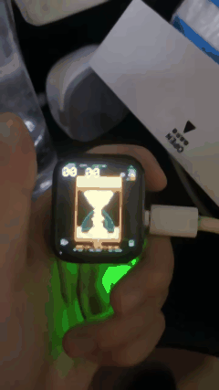
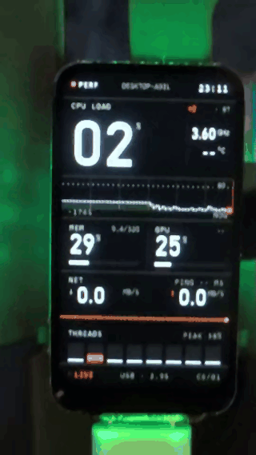

# LVGL Verify Loop

[](https://github.com/ZEQUAN-LIANG/lvgl-for-ai/releases)
[](LICENSE)
[](console/README.md)
[](scripts/meta/versions.json)

[English](README.md) | 简体中文

一个 headless 的 LVGL 运行时：跑起你的界面，用虚拟输入驱动它，逐帧录下来。AI 写 LVGL 的 C，看见实际发生了什么，再对照你给的验收标准自检。以 Claude Code skill 形式发布。

| 人 | AI |
| --- | --- |
| 给出意图与参考画面 | 写 LVGL 的 C 代码 |
| 在画面上圈出问题（标注、白板） | 跑场景，读帧、timeline、diff 与日志 |
| 给出验收标准 | 按标准自检、自验收、再修正 |

工具不输出 pass/fail；验收标准由人给出。

## 亮点

- **真实 LVGL，不需要屏幕。** 一个 headless 宿主里跑六个版本：9.6 / 9.5 / 9.4 / 9.1 / 8.4 / 8.3。
- **虚拟输入与虚拟时间。** 点击、拖拽、按键、编码器，以及一个确定性的时钟——没有墙钟带来的抖动。
- **每次运行都留下可回放的证据。** PNG 帧（只存画面变化的帧）、timeline、逐帧 diff bbox、引擎日志。
- **网页检视台** 在 `127.0.0.1:8765`：实时预览、会话回放，以及直接在真实画面上圈问题的标注与白板工具。
- **没有对象树、没有 `inspect`、没有 `set`。** 精确的内部状态由你的 C 代码 `printf` 到 `engine.log`，和其他产物一样进入证据。
- **以 skill 形式发布。** 一个 zip 带齐六个版本的预编译 LVGL 库与 engine；运行只需要 Python 3.9+。

## 安装

从 [GitHub Releases](https://github.com/ZEQUAN-LIANG/lvgl-for-ai/releases) 或 [Gitee Releases](https://gitee.com/liang-zequan/lvgl-for-ai/releases) 下载 0.2.3 的包：

- `lvgl-verify-loop-0.2.3-full-win64.zip` —— 六个 LVGL 版本与 viewer。
- `lvgl-verify-loop-0.2.3-full-sifli-win64.zip` —— 上面的完整包再加 SiFli 工具。

解压成 Claude Code 的个人 skill（Windows PowerShell）：

```powershell
Expand-Archive .\lvgl-verify-loop-0.2.3-full-win64.zip "$env:USERPROFILE\.claude\skills"
```

zip 里只有一层 `lvgl-verify-loop\`，所以解压后就是 `%USERPROFILE%\.claude\skills\lvgl-verify-loop\SKILL.md`。只给单个项目用，就解压到该项目的 `.claude\skills\`。右键 → **全部解压缩**同样可以。

重启 Claude Code，输入 `/lvgl-verify-loop`，或者直接描述你要的 LVGL 界面。

不用 AI 时，双击解压目录里的 `bin\LVGL-AI-Viewer.exe`（或运行 `bin\lvgl.cmd serve`）打开检视台。

直接在包里操作也行——skill 的命令都相对包根：

```bat
cd "%USERPROFILE%\.claude\skills\lvgl-verify-loop"
bin\lvgl.cmd run --scenario user\scenarios\intro.json --json
```

宿主机必须提供 Python 3.9+（`python`/`pythonw`，或 `py`/`pyw`）并在 PATH 上；发布包不自带运行时。运行包内应用不需要 CMake 或 GCC。AI 改完 C 后重新构建需要 GCC 15.2.0（MinGW-w64 64 位），必须与随包预编译 LVGL 库记录的编译器版本一致。

## 闭环

AI 直接改 `user/app/**/*.c`，用一条命令构建并播放场景：

```bash
python -I console/entrypoints/cli.py --lvgl 9.6 --scenario user/scenarios/settings.json --json
```

stdout 只有一行 JSON，指向这次会话：

```json
{"session_id": "20261121-181409-3dc9", "status": "ok", "display": {"width": 800, "height": 600}, "frame_count": 6, "effective_app": "test_ui", "lvgl": "9.6.0", "counts": {"clicks": 1, "drags": 1, "marks": 1, "snapshots": 2}, "truncated": false, "error": null}
```

AI 读这些证据、对照你给的验收标准，再决定是否修改。因为运行是确定性的、帧都落在磁盘上，同一个结论人也可以事后复查。

## 看懂证据

一次会话就是 `user/sessions/<id>/` 这个目录：

```text
user/sessions/<id>/
  manifest.json          # 状态、应用、分辨率、帧数
  timeline.ndjson        # 输入事件、帧区间、marks
  frame_diffs.ndjson     # 逐帧变化 bbox
  frames/                # 完整 PNG，只保留画面变化的帧
  snapshots/             # 命名快照
  engine.log             # 运行日志，精确状态由 C 代码 printf 到这里
  build.log              # 实际构建命令与编译器输出
  annotations.json       # 人的标注（可选）
  whiteboards.json       # 人的白板（可选；图片在 whiteboards/）
```

`status: ok` 只表示这次会话正常结束了，不代表界面正确。是否满足验收标准，由人判定。

三样东西对齐，修改才能有的放矢，而不是靠猜：

- **标注与白板** —— `annotations.json`、`whiteboards.json` 里的帧号、bbox、范围、文字与 labels。白板支持单帧、时间区间与全局三种范围，并且始终要求带文字或 labels，图像和文字一起交给 AI。
- **你的代码** —— `user/app/**/*.c` 是唯一源码真源；控件创建、`lv_obj_add_event_cb` 事件绑定与状态都在 C 里。
- **运行轨迹** —— `timeline.ndjson` 记录每次输入命中的对象名与类型（`hit` / `hit_class`），`frame_diffs.ndjson` 记录画面变化 bbox。

于是 AI 能知道控件由哪段代码创建、事件绑到哪个回调、这次输入命中了谁、画面随后变了哪块。

## 多版本验证

用户应用按 LVGL 9.4 基线编写，跑在 **9.6 / 9.5 / 9.4** 上，用 `--lvgl <version>` 选择；同一份 `user/app/**/*.c` 与同一个场景驱动这三个版本。跨版本比较事件语义与会话文件集合，不比较像素。

**9.1 / 8.4 / 8.3** 由同一个 engine 与同一套证据管线支持，作为遗留版本检查；但目录式应用发现的门是 9.4，所以这三个版本只显示空屏——适合核对事件语义，不适合预览应用。

## 真机

目前接通两块板。

### SiFli SF32LB52x（黄山派）

设备应用同样按 LVGL 9.4 基线编写；导出会复制应用源码并只做兼容性检查——遇到 9.5/9.6-only API 直接拒绝，不自动改写源码。

```bash
python -I chip-adapt/sifli/export.py sift_watch --dry-run
python -I chip-adapt/sifli/host/cli.py build --app sift_watch --actor ai --json
python -I chip-adapt/sifli/host/cli.py flash --app sift_watch --actor ai --json
```

黄山派实际屏幕 390×450，其他尺寸的应用需要自行适配布局。没有开发板时，只能停在宿主验证和导出 dry-run——不能声称设备已验证。

<p align="center"></p>

### ESP32-C6-LCD-1.47

`perf_monitor` 跑在微雪 ESP32-C6-LCD-1.47（172×320 ST7789）上，走 Arduino bring-up 链路：串口切换竖/横版，host 提供 `/perf/` 控制页和 tkinter 桌面面板。默认每 0.3 秒监控一次，导出/编译默认走增量：

```bash
python -I chip-adapt/esp32/arduino/build.py build
python -I chip-adapt/esp32/arduino/build.py flash --port COMx
python -I chip-adapt/esp32/host/host.py serve --port COMx --baud 115200 --open
python -I chip-adapt/esp32/host/perf/perf_gui.py
```

实机已验证 USB Serial/JTAG、esptool 烧录和 `SHOT` 帧缓冲抓取。正式 ESP-IDF 导出器仍在规划中。

<p align="center"></p>

## 从源码开始

```bash
git clone https://gitee.com/liang-zequan/lvgl-for-ai.git lvgl-for-agent
cd lvgl-for-agent

# 1. 下载并安装 LVGL 9.6 源码
python -I scripts/fetch_lvgl.py --version 9.6 --repo-root .

# 2. 下载 PNG 编码器源码（zlib / libpng）
python -I scripts/fetch_png.py --repo-root .

# 3. 跑一个场景（首次会构建 engine，通常需要几分钟）
python -I console/entrypoints/cli.py --lvgl 9.6 --scenario user/scenarios/settings.json

# 4. 打开网页检视台
python -I console/entrypoints/serve.py --open
```

成功时退出码为 `0`，stdout 最后一行是会话目录，`manifest.json` 的 `status` 为 `ok`。默认 `--source auto` 会先试 GitHub codeload，再试 Gitee 镜像；Gitee 的 LVGL 镜像可能返回 HTML/400，失败时请使用默认值或预编译版本包。

从源码开发？用 Claude Code 打开这个仓库即可；`CLAUDE.md` 说明仓库工作方式，`docs/skill/SKILL.md` 是 skill 入口，不需要另外安装 skill。

预编译 LVGL 库让本地只有 GCC 也能跑（`--prebuilt`）。工具与 Claude Code、Cursor 等 harness 无关，本身不绑定模型。

## 版本

- 宿主默认 LVGL 9.6，用于日常预览与取证；随包 `intro` 应用按 9.4+ 编写。
- 0.2.3 只发布两个 zip：`full` 带全部六个 LVGL 版本和 engine；`full-sifli` 再加 SiFli 工具。没有逐版本下载步骤。
- 随包 LVGL 库用 GCC 15.2.0 导出；走预编译路径重新编译用户 C 时需要同一个 GCC 版本。CMake/Ninja 只在从 LVGL 源码构建时需要。
- 查看版本，或只在自定义构建时使用源码安装：

  ```bash
  python -I scripts/install_version.py --list
  python -I scripts/install_version.py --lvgl 9.4 --mode source
  ```

  源码模式需要 CMake/Ninja/GCC。场景可选 `"lvgl": "9.4"`；`--lvgl` 优先于场景，场景优先于 `LVGL_VERIFY_LOOP_LVGL_VERSION`。
- SiFli 只在 `full-sifli` 里：导出/上位机层、`SiFli-Host.exe`、pyserial/xterm、`sift_watch` 源码和导出示例。不包含 SiFli SDK、ARM 工具链、sftool 或固件——见 `chip-adapt/vendor/README.md`。
- ESP32-C6 支持位于开发仓库 `chip-adapt/esp32/`；发布包不带 Arduino 导出器、host 或固件。

## 环境依赖

| 依赖 | 要求 | 说明 |
| --- | --- | --- |
| Python | 3.9+ 且在 PATH 上；发布包不自带 | 只用标准库；资产生成用随包 FreeType/pypng——不需要 `pip install`，也不需要 Node.js。命令统一用 `python -I` |
| GCC | MinGW-w64 64 位，15.2.0 | 只有重新编译用户 C 时需要；必须与随包 LVGL 库的 manifest 一致 |
| CMake | ≥ 3.20 | 仅从 LVGL 源码构建需要；发布包不需要 |
| Ninja | 任意近版 | 仅从 LVGL 源码构建需要；发布包不需要 |
| curl | 任意近版 | 仅下载 LVGL / PNG 源码时使用 |
| 磁盘 | 约 1 GB 可用 | LVGL 源码与构建产物 |

engine 在所有版本都链接随包 FreeType 2.13.2 并开启 `LV_USE_FREETYPE=1`。Windows 推荐 MSYS2 UCRT64。完整安装步骤、PATH 配置、首次运行说明与常见错误见 `console/README.md`。

## 说明

- 发布包只带 `intro` 一个应用——它同时是默认介绍页和默认模板。`user/app/` 下的其他应用只存在于开发仓库。
- 会话默认上限 600 帧、日志 16 MB；用 `LVGL_VERIFY_LOOP_MAX_FRAMES` 与 `LVGL_VERIFY_LOOP_MAX_LOG_BYTES` 改。
- 检视台与各 host 页面默认绑定 `127.0.0.1`。`serve.py` 用 `--host` / `--port`；ESP32 host 用 `--http-port`（它的 `--port` 是串口）。

## 更多文档

- `console/README.md`：工具用法、环境安装、常见错误、测试、静态检查与格式化。
- `user/app/GUIDE.md`：写用户应用。
- `docs/skill/`：skill 入口契约 `SKILL.md` 与各版本 `api-nav/`。
- `chip-adapt/sifli/README.md` / `chip-adapt/docs/sifli.html`：SiFli 适配层与能力边界。
- `chip-adapt/host/README.md`：ESP32（esptool）与 SiFli（sftool）上位机共享的 host 基础模块与独立烧录页。
- `chip-adapt/esp32/README.md`：ESP32-C6 板级说明、host 控制页、桌面 GUI 与 Arduino bring-up。
- `chip-adapt/esp32/docs/arduino-perf-monitor.md`：ST7789 + LVGL 旋转、烧录与 `SHOT` 验证说明。
- `CONTEXT.md`：领域术语表。
- `CLAUDE.md`：AI 编码代理的仓库工作说明。

## 许可

本项目源码为 MIT，见根目录 `LICENSE`。LVGL、lodepng、zlib、libpng、freetype-py、FreeType、pypng 的许可全文与 lv_font_conv 算法参考说明见 `docs/licenses/`。
