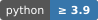
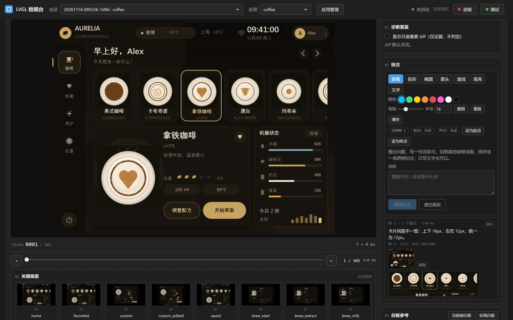
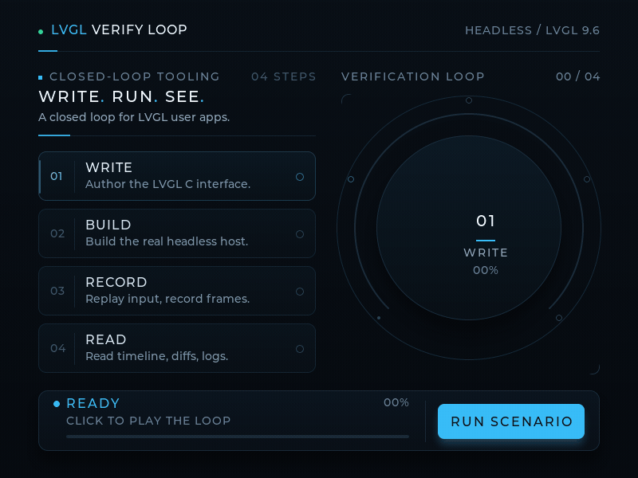
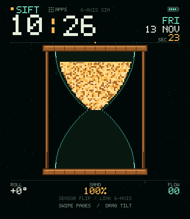
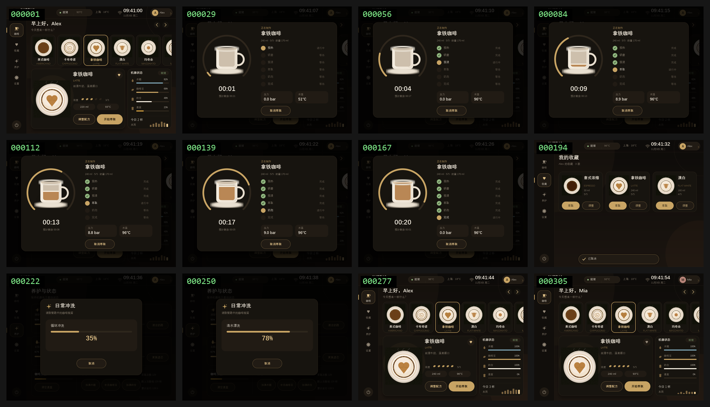

# LVGL AI

 

[English](README.md) | 简体中文

**AI 写 LVGL，AI 自己验证；人只提供意图与反馈。**

一个 AI-first 的 LVGL 开发与验证平台：真实 headless LVGL 宿主、虚拟输入与虚拟时间、逐帧会话证据、网页检视台，以及一条通向 SiFli 真机的导出链路。

<p align="center"></p>

## 为什么 AI-first

AI 时代，code is cheap。写 C 不再是瓶颈，缺的是让 AI 看见真实画面、拿到可判定证据的回路。

所以这个项目把 LVGL 开发交给 AI：AI 读意图、写 C、跑场景、读证据、自己验收。人不写代码，只提供意图、在画面上给出反馈、给出验收标准。

一切都是 AI-first：AI 在开发者的位置上，人退到意图与反馈。

| 人 | AI |
| --- | --- |
| 提供意图与参考画面 | 写 LVGL C 代码 |
| 在画面上圈出问题（标注、白板） | 跑场景，读帧、timeline、diff 与日志 |
| 给出验收标准与最终判断 | 按验收标准自检、自验收、再修正 |

它适合用 AI 编写 LVGL 界面、需要可回放证据的团队；不适合做 GPU 性能分析。

## 它能做什么

### 默认介绍页：把验证回路跑一遍

`user/app/intro/` 是 skill 的默认应用，也是默认模板。下面的 GIF 来自一次真实会话（`user/scenarios/intro.json`）：

<p align="center"></p>

### AI 闭环：改 C → 跑场景 → 读证据 → 自己判定

AI 直接修改 `user/app/**/*.c`，用一条命令构建并播放场景：

```bash
python -I core/cli.py --lvgl 9.6 --scenario user/scenarios/coffee.json --json
```

stdout 只有一行 JSON，指向一次会话；会话里有完整 PNG 帧、timeline、逐帧 diff 和引擎日志。AI 读这些证据、对照人给的验收标准，再决定是否修改。工具不输出 pass/fail，验收标准由人给出。

没有对象树、`inspect`、属性读取或 `set`：精确的内部状态由用户 C 代码 `printf` 到 `engine.log`，同样进入证据。

### 网页检视台：实时预览、回放、标注、白板

```bash
python -I core/web.py --open
```

固定 `127.0.0.1:8765`。页面里是真实 LVGL 运行时的画面，可以实时预览或回放录制会话；右侧是标注工具，人在画面上圈出问题、写一句话，保存为标注。

白板支持单帧、时间区间与全局三种范围，适合画流程、讲意图；每块白板都要求文字或 labels，图像和文字一起交给 AI。

AI 直接读这些材料：

- 标注与白板：`annotations.json`、`whiteboards.json` 里的帧号、bbox、范围、文字与 labels；
- 用户代码：`user/app/**/*.c` 是唯一源码真源，控件创建、`lv_obj_add_event_cb` 事件绑定与状态都在 C 里；
- 运行轨迹：`timeline.ndjson` 记录每次输入命中的对象名与类型（`hit` / `hit_class`），`frame_diffs.ndjson` 记录画面变化 bbox。

三者对齐后，AI 能知道控件由哪段代码创建、事件绑到哪个回调、这次输入命中了谁、画面随后变了哪块，再按标注和白板的反馈改代码。下面的动画来自真实会话的逐帧 PNG：

<p align="center"></p>

### 多版本验证：一套应用，六个 LVGL 版本

同一份 `user/app` 与同一个场景，可以跑在 LVGL 9.6 / 9.5 / 9.4 / 9.1 / 8.4 / 8.3 上，用 `--lvgl <version>` 选择。跨版本比较事件语义与会话文件集合，不比较像素。

设备应用按 LVGL 9.4 基线编写；导出时只做兼容性检查并拒绝 9.5/9.6-only API。

### 真机链路：宿主验证，SiFli 导出 → 构建 → 烧录

```bash
python -I chip-adapt/sifli/export.py sift_watch --dry-run --force
python -I chip-adapt/sifli/host/cli.py build --app sift_watch --actor ai --json
python -I chip-adapt/sifli/host/cli.py flash --app sift_watch --actor ai --json
```

共享源码仍是 `user/app/`；导出按 LVGL 9.4 基线复制应用源码。没有开发板时，只能停在宿主验证和导出 dry-run，不能声称设备已验证。

黄山派（SiFli SF32LB52x，板名 `sf32lb52-lchspi-ulp`）实拍，桌面串口与烧录上位机在 `chip-adapt/sifli/host/`。黄山派实际屏幕 390×450，其他尺寸的应用需要自行适配布局：

<p align="center"><video src="docs/media/huangshanpai.mp4" controls width="280"></video></p>

[打开视频](docs/media/huangshanpai.mp4)

另外两点：预编译宿主 SDK 让本地只有 GCC 也能跑（`--prebuilt`）；工具与 Claude Code、Cursor 等 harness 无关，本身不绑定模型。

## 快速开始

```bash
git clone https://gitee.com/liang-zequan/lvgl-for-ai.git lvgl-for-agent
cd lvgl-for-agent

# 1. 下载并安装 LVGL 9.6 源码
python -I core/tools/fetch_lvgl.py --version 9.6 --repo-root .

# 2. 下载 PNG 编码器源码（zlib / libpng）
python -I core/tools/fetch_png.py --repo-root .

# 3. 跑一个场景（首次会构建 engine，通常需要几分钟）
python -I core/cli.py --lvgl 9.6 --scenario user/scenarios/settings.json

# 4. 打开网页检视台
python -I core/web.py --open
```

成功时退出码为 `0`，stdout 最后一行是会话目录，`manifest.json` 的 `status` 为 `ok`。默认 `--source auto` 会先试 GitHub codeload，再试 Gitee 镜像；Gitee 的 LVGL 镜像可能返回 HTML/400，失败时请使用默认值或预编译版本包。

预编译 0.2.0 发布包：从同一个 Release 下载 `lvgl-verify-loop-0.2.0-core-win64.zip` 和可选的版本 pack。解压 core 后双击 `LVGL-AI-Viewer.exe`，不需要 Python、GCC 或 CMake。运行 `bin\lvgl.cmd run --lvgl 9.4 ...` 会先询问一次是否下载 9.4 pack；`--yes` 跳过询问，`--offline` 禁止下载。`sifli-tools` 是独立资产，顶层同样是 `lvgl-verify-loop/`；把两个 zip 解压到同一个父目录即可合并。

要让 AI 接手，把这个仓库交给 Claude Code、Cursor 等 harness，它会读取 `core/SKILL.md` 与 `CLAUDE.md`，从 `user/app/**/*.c` 开始写。Claude Code 里的 skill 名是 `lvgl-verify-loop`。

## 看懂证据

一次会话就是 `sessions/<id>/` 这个目录：

```text
sessions/<id>/
  manifest.json          # 状态、应用、分辨率、帧数
  timeline.ndjson        # 输入事件、帧区间、marks
  frame_diffs.ndjson     # 逐帧变化 bbox
  frames/                # 完整 PNG，只保留画面变化的帧
  snapshots/             # 命名快照
  engine.log             # 运行日志，精确状态由 C 代码 printf 到这里
  build.log              # 实际构建命令与编译器输出
  annotations.json       # 人的标注（可选）
```

`--json` 的 stdout 只有一行，例如（截取关键字段，路径已简化）：

```json
{"session_id": "20261114-095536-1d9d", "session_dir": "sessions/20261114-095536-1d9d", "status": "ok", "app": "coffee", "display": {"width": 800, "height": 600}, "frame_count": 305, "error": null}
```

一次会话里抽出的 12 帧完整 PNG：

<p align="center"></p>

AI 的结论必须指向这些文件。`status: ok` 表示会话正常结束；界面是否满足验收标准，由人判定。

## 版本与真机

- 宿主默认 LVGL 9.6，用于日常预览与取证；发布包里的 `intro` 应用按 9.4+ 编写。
- 0.2.0 发布一个 core 包，以及 9.5 / 9.4 / 9.1 / 8.4 / 8.3 的预编译 pack。core 包内置
  Python 3.11 和 9.6 engine；缺失版本首次运行会先确认再下载。
- 设备应用按 LVGL 9.4 基线编写；导出只做兼容性检查，不自动改写源码。
- 查看或安装版本：

  ```bash
  python -I core/tools/install_version.py --list
  python -I core/tools/install_version.py --lvgl 9.4 --mode pack
  python -I core/tools/install_version.py --lvgl 9.4 --mode source
  ```

  pack 模式校验 sha256，不需要 CMake/Ninja；源码模式需要 CMake/Ninja/GCC。
  场景可选 `"lvgl": "9.4"`；`--lvgl` 优先于场景，场景优先于 `LVGL_AI_LVGL_VERSION`。
  `--offline` 禁止下载；`--yes` 跳过确认。
- SiFli 在单独的 `sifli-tools` 资产里：包含自研导出/上位机层、`SiFli-Host.exe`、
  pyserial/xterm 和 `sift_watch` 导出示例；不包含 SiFli SDK、ARM 工具链、sftool 或
  固件。SDK、工具链与 sftool 安装见 `chip-adapt/vendor/README.md`。

## 环境依赖

| 依赖 | 要求 | 说明 |
| --- | --- | --- |
| Python | 发布包内置 3.11.9；源码仓库 ≥ 3.9 | 只用标准库，不需要 `pip install`；engine 在所有版本默认 `LV_USE_FREETYPE=1` 并链接随包 FreeType 2.13.2；命令统一用 `python -I` |
| GCC | MinGW-w64 64 位 | 只有重新编译用户 C 时需要；发布包预编译 engine 不需要 |
| CMake | ≥ 3.20 | 仅源码构建需要 |
| Ninja | 任意近版 | 仅源码构建需要 |
| curl | 任意近版 | 仅下载 LVGL / PNG 源码时使用 |
| 磁盘 | 约 1 GB 可用 | LVGL 源码与构建产物 |

Windows 推荐 MSYS2 UCRT64。完整安装步骤、PATH 配置、首次运行说明与常见错误见 `core/README.md`。

## 更多文档

- `core/README.md`：工具用法、环境安装、常见错误、测试。
- `user/app/GUIDE.md`：写用户应用。
- `docs/index.html`：英文项目介绍页；`docs/app.html` / `docs/scenario-server.html`：应用变体、场景与服务端常量索引。
- `chip-adapt/README.md` / `chip-adapt/docs/sifli.html`：SiFli 适配层与能力边界。
- `CONTEXT.md`：领域术语表。
- `CLAUDE.md`：AI 编码代理的仓库工作说明。
- `core/SKILL.md`：可分发 skill 的 AI 入口契约与 agent 工作流。

## 许可

本项目源码为 MIT，见根目录 `LICENSE`。LVGL、lodepng、zlib、libpng 的许可全文见 `licenses/`，声明见 `core/THIRD_PARTY_NOTICES.md`。
