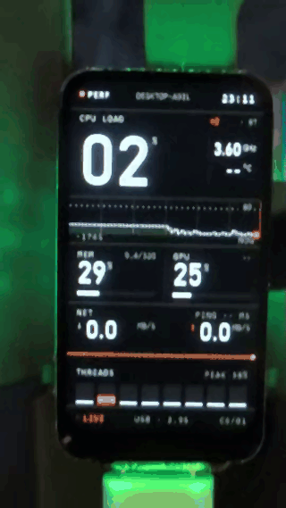

# ESP32-C6 适配区

目标板：微雪 **ESP32-C6-LCD-1.47（无触摸，172×320，ST7789，4 MB Flash，无 PSRAM）**。
目标软件基线：ESP-IDF 5.5.x / LVGL 9.6 / `esp_lvgl_port` 2.9；当前可烧录的
`perf_monitor` bring-up 使用 Arduino-ESP32 3.3.10-cn + LVGL 9.6。

> 实机记录：当前开发板为 ESP32-C6FH4，`esptool flash_id` 报 **8 MB Flash**（官方文档
> 写 4 MB，微雪 demo 也打印 `Flash size: 8 MB`）。做分区表前先按实际批次确认容量。

## 演示

`perf_monitor` 在 172×320 / 320×172 之间串口切换；host 的 `/perf/` 页面和 tkinter GUI
都可以控制 Demo/Live、发送周期（默认 0.3 秒）和横竖版。下面是实机拍摄（无音频，
不是 headless 预览）：

<p align="center"></p>

## 当前状态

| 区域 | 状态 | 说明 |
| --- | --- | --- |
| `host/` | 可运行原型 | 复用 SiFli host 的 `SerialBroker`；页面 + Wi-Fi + 蓝牙 + 串口 + 系统网页；独立烧录页 `/flash/`，CLI + fake backend |
| LVGL demo | 可运行 | `user/app/c6_demo/`，3 页，172×320，headless 场景 `user/scenarios/c6_demo.json` |
| 性能监控器 | 可运行（真机已验证） | `user/app/perf_monitor/`，172×320 / 320×172 串口切换；host `/perf/` + tkinter GUI；协议与 PC 发送端见其 README |
| 桌面控制 GUI | 可运行 | `host/perf/perf_gui.py`，走 host HTTP API，不直接占用 COM 口 |
| Wi-Fi / 蓝牙配置 UI | 已实现 | 网页扫描/连接/开关/改名/可发现；串口协议见 `host/README.md` |
| 官方文档镜像 | 已抓取 | `docs/ESP32-C6-LCD-1.47/`，7 个页面 + 本地截图（2026-11-18） |
| Arduino 演示固件 | 可运行（已烧录验证） | `arduino/build.py` + `arduino/templates/`；LVGL 9.6 + ST7789，临时 bring-up；**UART + BLE 双通道**；见 `docs/arduino-perf-monitor.md` |
| UART + BLE 运行时 | 已实现 | host 同时维护 USB 串口与 BLE（NUS），BLE 连上优先，否则回退 UART；`host.py serve` 默认 `dual`；BLE 依赖用 `host/scripts/bootstrap.ps1` 安装 |
| 导出器 | 未实现 | ESP-IDF 导出器与模板待补；见下方“固件侧待做” |
| ESP-IDF 固件壳 | 未实现 | 需要 `app_main.c` + ST7789 + `esp_lvgl_port` + `esp_console` 胶水 |
| 烧录器（esptool） | 可运行（真机已验证） | 独立网页 `/flash/`（与 SiFli host 共用同一套页面，后端不同）+ CLI；解析 `.bin`、`.zip`、ESP-IDF build 目录；释放串口后调用 esptool；`host/scripts/bootstrap.ps1` 装 `esptool==4.8.1`。真机：ESP32-C6FH4 / COM13，微雪 demo 4 MB @ `0x0`，verify OK |

## 快速入口

```bash
# LVGL demo（headless，不需要板子）
python -I console/entrypoints/cli.py --lvgl 9.6 \
  --scenario user/scenarios/c6_demo.json --json
python -I console/entrypoints/cli.py --lvgl 9.6 \
  --scenario user/scenarios/perf_monitor.json --json
python -I console/entrypoints/cli.py --lvgl 9.6 --scenario user/scenarios/perf_monitor_landscape.json --json

# 性能监控器演示帧（不发串口）
python -I chip-adapt/esp32/host/perf/perf_agent.py --demo --dry-run --once

# 临时 Arduino 演示固件（先启动 host 再烧录；默认增量编译）
python -I chip-adapt/esp32/arduino/build.py build
python -I chip-adapt/esp32/arduino/build.py flash --port COMx

# 上位机（fake 串口，不需要板子）
python -I chip-adapt/esp32/host/host.py serve --fake --open
python -I chip-adapt/esp32/host/tests/run_tests.py

# 上位机（默认 UART + BLE，BLE 连上优先，否则 UART）
python -I chip-adapt/esp32/host/host.py serve --open

# 只走串口 / 只走 BLE
python -I chip-adapt/esp32/host/host.py serve --transport serial --serial-port COMx --open
python -I chip-adapt/esp32/host/host.py serve --transport ble --ble-name LVGL-C6-PERF --open

# 桌面 GUI（host 已启动）
python -I chip-adapt/esp32/host/perf/perf_gui.py

# 烧录（先装 esptool 与 bleak；不加 --fake 时走真机）
powershell -NoProfile -ExecutionPolicy Bypass -File chip-adapt/esp32/host/scripts/bootstrap.ps1
python -I chip-adapt/esp32/host/host.py flash \
  --zip chip-adapt/vendor/esp32/demo/ESP32-C6-LCD-1.47-Demo.zip --port COMx
```

网页默认 `http://127.0.0.1:8767/`；烧录器是独立页 `http://127.0.0.1:8767/flash/`，
性能监控控制页是 `http://127.0.0.1:8767/perf/`；桌面版是
`python -I chip-adapt/esp32/host/perf/perf_gui.py`（tkinter，走同一套 host API）。页面列表来自
固件，不在前端写死。

## 文档资料

`docs/` 是微雪官方文档的离线镜像，入口 `docs/ESP32-C6-LCD-1.47/00-overview.md`。
覆盖产品页、相关资料、Arduino、ESP-IDF、固件烧录、FAQ、技术支持 7 个页面；正文截图已
下载到 `docs/ESP32-C6-LCD-1.47/images/`。示例程序、原理图、数据手册、调试工具与视频在
`chip-adapt/vendor/esp32/`（不进 Git，清单见 `chip-adapt/vendor/README.md`）。

烧录器使用、共享页 API、双后端契约与排障见 `chip-adapt/host/README.md`。

## 功能取舍

这一轮先做“能演示、能验证”的闭包：

- **保留**：页面切换、背光、Wi-Fi 扫描/连接/状态/自动连接、蓝牙开关/广播名/可发现/
  连接数、串口端口/波特率/自动重连/行尾/日志、系统信息/重置。
- **暂不做**：OTA、静态 IP/DNS、BLE 配对/绑定管理、设备端 Wi-Fi/蓝牙设置页。
  这些会显著增加固件状态机和内存占用；C6 只有 512 KB SRAM、无 PSRAM，Wi-Fi + BLE +
  LVGL 同时开要先用 `idf.py size` 和实测 heap 评估。
- **真实驱动**：网页和 host 协议已就绪；Wi-Fi 用 `esp_wifi`，蓝牙用 NimBLE
  (`esp_nimble`) 在 ESP-IDF 固件壳里实现，下一阶段做。

## 已完成（perf_monitor）

- 172×320 / 320×172 布局与 `PERF PORTRAIT` / `PERF LANDSCAPE` 串口切换；
- 默认 0.3 秒监控周期，底栏显示实测周期；
- ST7789 软件旋转 flush，修复横版花屏；
- host `/perf/` 控制页、`perf/perf_control.py`、`perf/perf_agent.py` 与 `perf/perf_gui.py`；
- Arduino 固件真机烧录，`SHOT` 4 bpp 帧缓冲自检。

## 固件侧待做

1. 安装 ESP-IDF 5.5.x，跑通 `hello_world` 和 `esptool.py --chip esp32c6 flash_id`。
2. 新建 `chip-adapt/esp32/templates/` 与 `export.py`：ST7789 + `esp_lvgl_port` 的
   `app_main.c`，以及 `sdkconfig.defaults` / `partitions.csv` / `main/CMakeLists.txt`。
3. 加 `esp_console` 的 USB Serial/JTAG REPL，注册 `pages` / `page` / `state` / `ping`，
   调用 `user/app/c6_demo` 暴露的 `c6_demo_page_*` API。
4. 真机验证：网页按钮 -> 串口命令 -> 屏幕切页，保留串口日志与屏幕照片/录屏。
5. 把 `idf.py build` 接进 host；烧录后端已用 esptool 实现，构建仍待接。

## 边界

- 不在 `chip-adapt/esp32/` 里再写一套串口客户端；host 复用 SiFli 的 broker。
- 网页不直接用 Web Serial 抢 COM 口；CLI、网页、AI 都走同一个 host。
- 不输出 pass/fail、baseline、approval、acceptance；只保留日志、响应和截图证据。
- 导出物放 `chip-adapt/exports/esp32/<app>/`，不进 Git。
