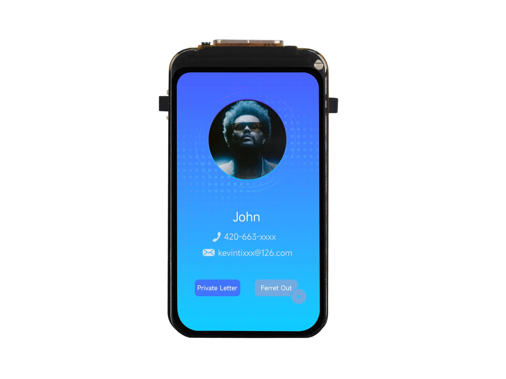
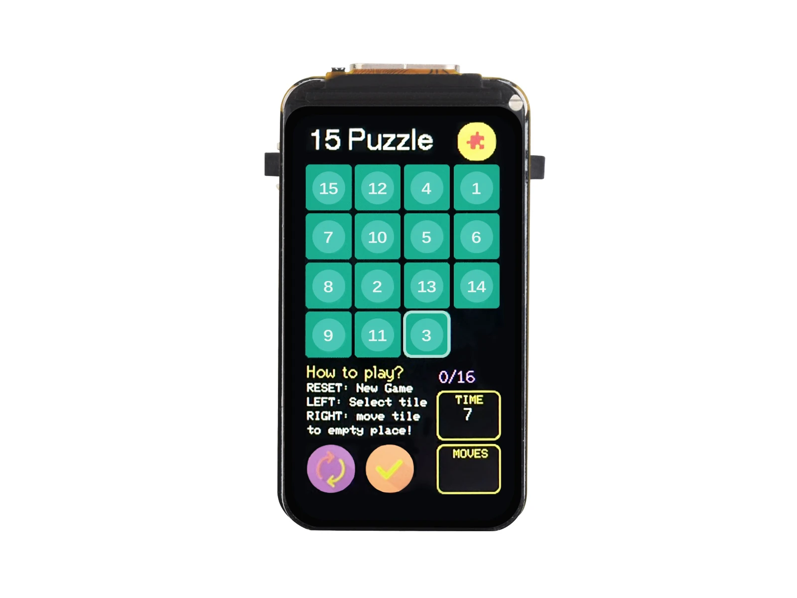
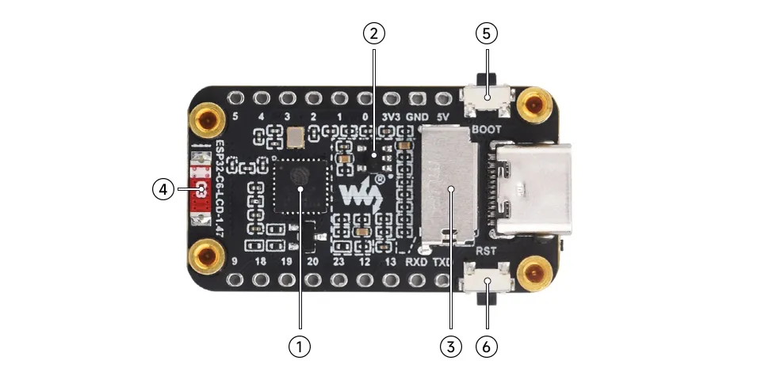
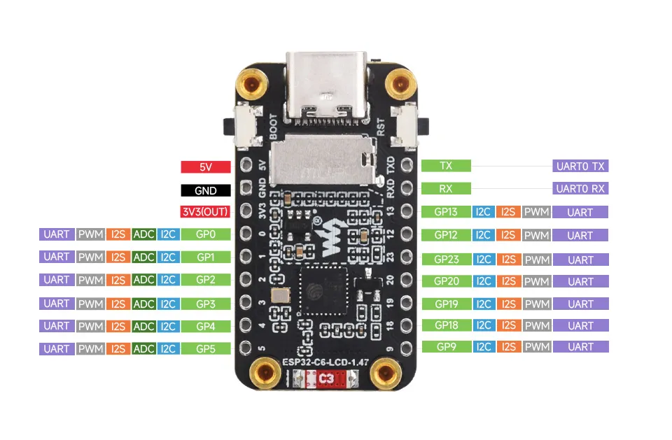
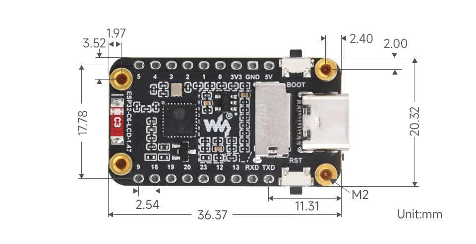

<!-- 来源：https://docs.waveshare.net/ESP32-C6-LCD-1.47/ 抓取日期：2026-11-18。内容版权归微雪电子（Waveshare）所有，此处仅为本地开发参考资料。 -->

# ESP32-C6-LCD-1.47

**ESP32-C6-LCD-1.47**

**ESP32-C6-LCD-1.47-M（排针版）**

> **注意**
>
> 焊接排针时无需拆下屏幕，倾斜烙铁角度直接焊接即可。
>
> **注意**
>
> 使用时请务必将屏幕亮度控制在 50% 以内，切勿长时间满亮度运行。亮度过高会使屏幕温度升高，温度过高可能导致屏幕出现黑色阴影，影响正常显示。
>
> 如显示出现异常，请将开发板静置一段时间后，再烧录较低亮度的程序使用。

| SKU | 产品 |
| --- | --- |
| 28563 | ESP32-C6-LCD-1.47 |
| 30381 | ESP32-C6-LCD-1.47-M |

## 产品简介

ESP32-C6-LCD-1.47 是一款支持 2.4GHz Wi-Fi 6 和蓝牙 BLE 5 的微控制器开发板。叠封 4MB Flash，板载 1.47 英寸 LCD 屏，可流畅运行 LVGL 等 GUI 界面程序；结合多种外设接口，可快速开发 ESP32-C6 的 HMI 等应用。

**如果你在寻找：**

- **产品资料**：参见 [ESP32-C6-LCD-1.47 相关资料](01-resources-and-documents.md)

- **Arduino 开发**：参见 [Arduino 开发](02-arduino.md)

- **ESP-IDF 开发**：参见 [ESP-IDF 开发](03-esp-idf.md)

- **固件烧录**：参见 [Flash 固件的烧录与擦除](04-firmware-flashing.md)

- **问题排查**：参见 [产品 FAQ](05-faq.md) 或联系 [技术支持](06-technical-support.md)

## 产品特性

- 搭载高性能 RISC-V 32 位处理器和低功耗 RISC-V 32 位处理器，高性能处理器时钟高达 160MHz，低功耗处理器时钟可达 20MHz

- 支持 2.4 GHz Wi-Fi 6 (802.11 ax/b/g/n) 和 Bluetooth 5(LE)，板载天线

- 板载 320KB ROM、512KB HP SRAM、16KB LP SRAM 和 4MB flash

- 板载 1.47 英寸 LCD 屏，172 × 320 分辨率，262K 彩色

- 引出大部分 GPIO，集成全速 USB 串口

- 板载 Micro SD 卡座，可外接 SD 卡存储图片或文件

- 支持灵活时钟，多种电源模式等准确控制，实现多场景低功耗模式

- 板载 RGB 彩色灯珠，搭配透明亚克力夹层可实现酷炫灯光效果

## 资源简介

1. **ESP32-C6FH4**

2. **ME6217C33M5G** 低压降 LDO，电流（MAX）800mA

3. **Micro SD 卡座**

4. **贴片陶瓷天线**

5. **BOOT 按键**

6. **RESET 按键**

## 接口介绍

- LCD

| LCD 引脚 | ESP32C6 |
| --- | --- |
| MOSI | GPIO6 |
| SCLK | GPIO7 |
| LCD_CS | GPIO14 |
| LCD_DC | GPIO15 |
| LCD_RST | GPIO21 |
| LCD_BL | GPIO22 |

- RGB 灯珠

| RGB 灯珠 | ESP32C6 |
| --- | --- |
| RGB_Control | GPIO8 |

- SD Card

| SD Card | ESP32C6 |
| --- | --- |
| MISO | GPIO5 |
| MOSI | GPIO6 |
| SCLK | GPIO7 |
| CS | GPIO4 |
| SD_D1 | NC |
| SD_D2 | NC |

## 产品尺寸

## 产品参数

| 参数名称 | 参数 |
| --- | --- |
| 接口 | USB Type-C |
| 主控芯片 | ESP32-C6 |
| 屏幕类型 | TFT |
| 屏幕控制芯片 | Display:ST7789 |
| 板载设备 | Micro SD |

## 开发方式

> **注意**
>
> 使用时请务必将屏幕亮度控制在 50% 以内，切勿长时间满亮度运行。亮度过高会使屏幕温度升高，温度过高可能导致屏幕出现黑色阴影，影响正常显示。
>
> 如显示出现异常，请将开发板静置一段时间后，再烧录较低亮度的程序使用。

ESP32-C6-LCD-1.47 支持 Arduino IDE 和 ESP-IDF 两种开发框架，为开发者提供灵活的选择，您可以根据项目需求和个人偏好选择合适的开发工具。

Arduino 通常更容易上手，对初学者和爱好者更加友好。ESP-IDF 提供更完整的开发工具链和更细粒度的系统控制，适合复杂项目或对性能有较高要求的应用。

- **Arduino IDE** 是一款便捷灵活、易于上手的开源电子原型平台。无需太多基础知识，简单学习后即可快速开发。Arduino 拥有庞大的全球用户社区，提供海量开源代码、项目示例和教程，以及丰富的库资源，封装了复杂功能，让开发者能够快速实现各种功能。您可以参考 **[Arduino IDE 开发环境搭建教程](02-arduino.md)** 完成初始设置，教程中同时提供了相关示例程序供参考。

- **ESP-IDF** 全称 Espressif IoT Development Framework，是乐鑫科技为 ESP 系列芯片推出的专业开发框架。它基于 C 语言开发，包含编译器、调试器、烧录工具等，支持命令行或集成开发环境（如 Visual Studio Code 配合 Espressif IDF 插件）开发，插件提供代码导航、项目管理、调试等功能。我们推荐使用 VS Code 进行开发，具体配置过程可参考 **[ESP-IDF (VS Code) 开发环境搭建教程](03-esp-idf.md)**，教程中同时提供了相关示例程序供参考。
