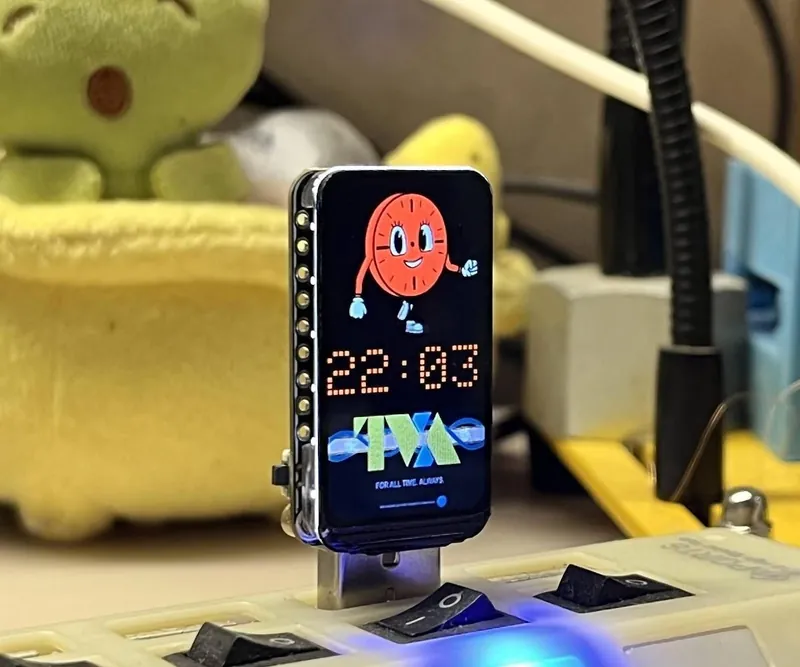
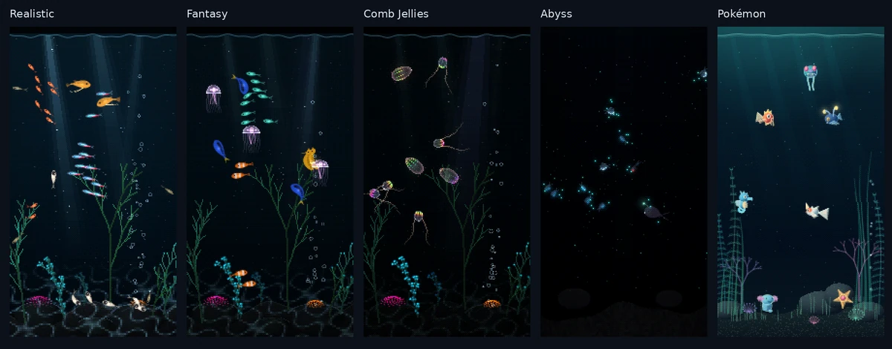
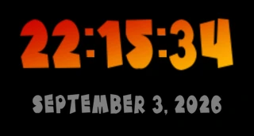
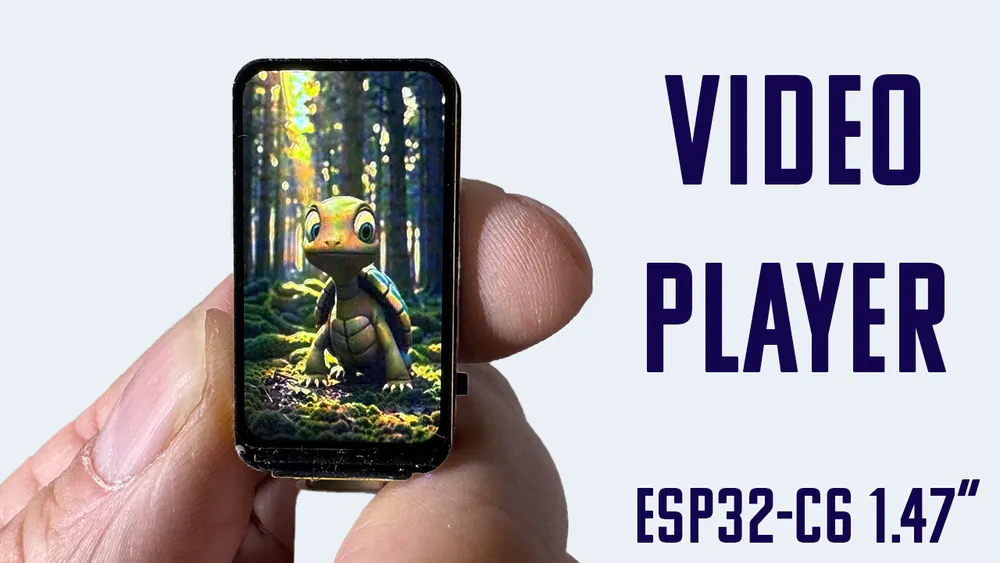

<!-- 来源：https://docs.waveshare.net/ESP32-C6-LCD-1.47/Resources-And-Documents/ 抓取日期：2026-11-18。内容版权归微雪电子（Waveshare）所有，此处仅为本地开发参考资料。 -->

# 相关资料

## 1. 示例程序

- [ESP32-C6-LCD-1.47 示例程序](https://files.waveshare.net/wiki/ESP32-C6-LCD-1.47/ESP32-C6-LCD-1.47-Demo.zip)

## 2. 硬件资料

- [ESP32-C6-LCD-1.47 原理图](https://www.waveshare.net/w/upload/c/c3/ESP32-C6-LCD-1.47_schemetics.pdf)

- [ESP32-C6-LCD-1.47 工程图纸](https://www.waveshare.net/w/upload/9/9f/ESP32-C6-LCD-1.47-3D_Drawing.rar)

## 3. 技术手册

- **ESP32-C6 芯片官方手册**

  - 技术规格书：[中文版](https://documentation.espressif.com/esp32-c6_datasheet_cn.pdf) | [英文版](https://documentation.espressif.com/esp32-c6_datasheet_en.pdf)

  - 技术参考手册：[中文版](https://documentation.espressif.com/esp32-c6_technical_reference_manual_cn.pdf) | [英文版](https://documentation.espressif.com/esp32-c6_technical_reference_manual_en.pdf)

## 4. 软件工具

- 串口调试：[串口和网络调试助手](https://www.waveshare.net/w/upload/b/b3/Sscom5.13.1.zip)

- Flash 烧录：[Flash 调试软件](https://dl.espressif.com/public/flash_download_tool.zip)

- 蓝牙调试：[蓝牙调试助手](https://www.waveshare.net/w/upload/2/2e/ESP32-C6_TO_BLEAssist.zip)

## 5. 其他资料

- [ESP32-C6-LCD-1.47 LVGL视频教程（外）](https://files.waveshare.net/wiki/ESP32-C6-LCD-1.47/ESP32-C6-LVGL-Video.mp4)

## 6. 社区示例展示

> **信息**
>
> 以下项目由社区创作者独立维护，相关内容以项目页面为准。

### moononournation - Loki Miss Minutes 时钟

图片来源：moononournation — [GIF Animation Clock 项目实物图](https://content.instructables.com/FMD/C9CR/MHMCIN0W/FMDC9CRMHMCIN0W.jpg)。

Miss Minutes 时钟通过 Wi-Fi 同步网络时间，在 ESP32-C6-LCD-1.47 上显示时分与《洛基》中的 Miss Minutes 角色 GIF 动画。

- 项目教程（Instructables）：[https://www.instructables.com/GIF-Animation-Clock/](https://www.instructables.com/GIF-Animation-Clock/)

- 固件源码（GitHub 仓库）：[https://github.com/moononournation/animation_clock](https://github.com/moononournation/animation_clock)

### CommunityFan89 - 数字水族箱

图片来源：Sparkadium — [Digital-Aquarium 项目图片](https://github.com/user-attachments/assets/c8fd4379-30ec-4c6a-8927-1cdf459d612a)。

Digital-Aquarium（Glowtank）为非触摸版 ESP32-C6-LCD-1.47 提供程序生成的水族箱动画，可通过 BOOT 按钮投喂、切换场景和横竖屏，作者注明当前版本尚未进行实机验证。

- 固件源码（GitHub 仓库）：[https://github.com/Sparkadium/Digital-Aquarium](https://github.com/Sparkadium/Digital-Aquarium)

### Marcel van Eck - 迷你时钟与渐变灯效

图片来源：maeck70 — [Waveshare-ESP32-C6-LCD-Clock 项目预览图](https://raw.githubusercontent.com/maeck70/Waveshare-ESP32-C6-LCD-Clock/37756e788aed9a6b4b85cbcad3967f05422df507/preview.png)。

该时钟项目显示时间与日期，通过 Wi-Fi 或 USB 串口校时，并将屏幕渐变色与板载 RGB LED 灯效同步。

- 固件源码（GitHub 仓库）：[https://github.com/maeck70/Waveshare-ESP32-C6-LCD-Clock](https://github.com/maeck70/Waveshare-ESP32-C6-LCD-Clock)

### The Last Outpost Workshop - SD 卡视频播放器

图片来源：The Last Outpost Workshop — [ESP32-C6 视频播放器项目封面](https://raw.githubusercontent.com/thelastoutpostworkshop/images/main/videoplayer.png)。

该播放器读取 SD 卡中的 MJPEG 视频并依次循环播放，可通过板载按钮切换到下一个视频，项目同时提供视频格式转换说明。

- 固件源码（GitHub 仓库）：[https://github.com/thelastoutpostworkshop/ESP32-C6-LCD-1.47_video_player](https://github.com/thelastoutpostworkshop/ESP32-C6-LCD-1.47_video_player)

### Volos Projects - LVGL 与 SquareLine Studio UI 示例

该项目提供 SquareLine Studio 工程及导出的 LVGL 界面代码，在 ESP32-C6-LCD-1.47 上演示数值、图表和进度条显示。

- 示例源码（GitHub 仓库）：[https://github.com/VolosR/WaveShareC6lvglexample](https://github.com/VolosR/WaveShareC6lvglexample)

### nishad2m8 - SquareLine Studio 板级支持包

该项目提供 ESP32-C6-LCD-1.47 的 SquareLine Studio 自定义板级支持包，用于配置显示尺寸及 LVGL 界面导出工程。

- 板级支持包（GitHub）：[https://github.com/nishad2m8/Squareline-OBP/tree/master/WaveShare/esp32-c6-1.47](https://github.com/nishad2m8/Squareline-OBP/tree/master/WaveShare/esp32-c6-1.47)
