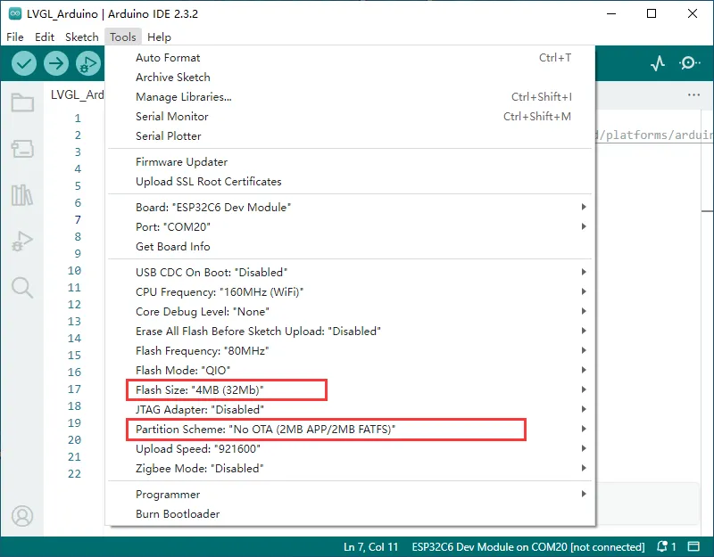
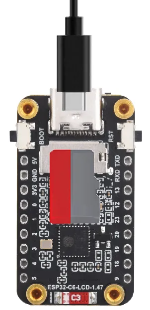
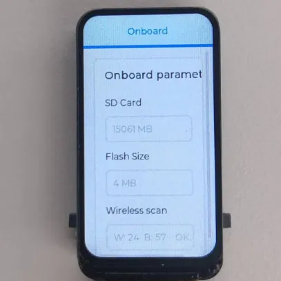
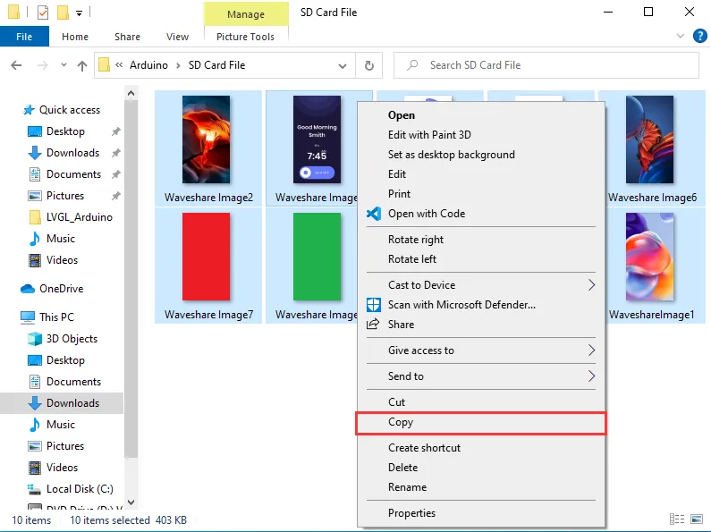
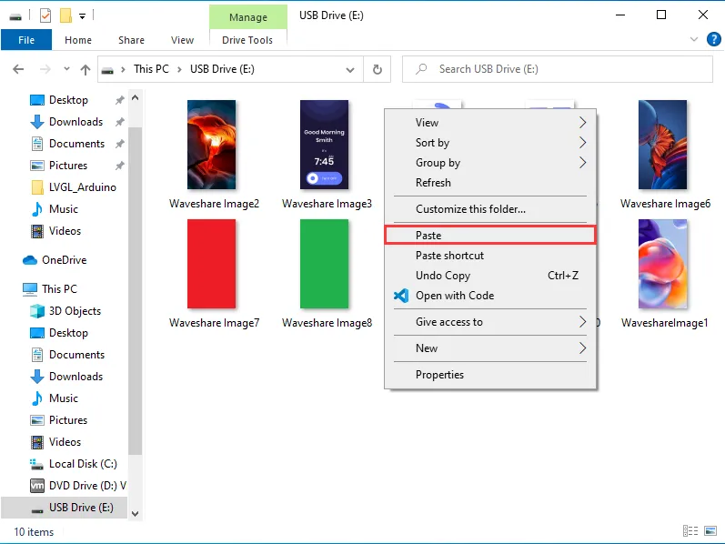
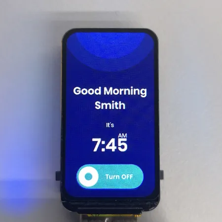
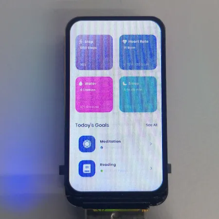

<!-- 来源：https://docs.waveshare.net/ESP32-C6-LCD-1.47/Arduino/ 抓取日期：2026-11-18。内容版权归微雪电子（Waveshare）所有，此处仅为本地开发参考资料。 -->

# ESP32-C6-LCD-1.47 Arduino 开发

> **注意**
>
> 使用时请务必将屏幕亮度控制在 50% 以内，切勿长时间满亮度运行。亮度过高会使屏幕温度升高，温度过高可能导致屏幕出现黑色阴影，影响正常显示。
>
> 如显示出现异常，请将开发板静置一段时间后，再烧录较低亮度的程序使用。

本章节包含以下部分，请按需阅读：

- [Arduino 入门教程](#arduino-tutorial)

- [配置开发环境](#%E9%85%8D%E7%BD%AE%E5%BC%80%E5%8F%91%E7%8E%AF%E5%A2%83)

- [示例程序](#%E7%A4%BA%E4%BE%8B%E7%A8%8B%E5%BA%8F)

## Arduino 入门教程

初次接触 Arduino ESP32 开发，想要快速上手？我们为您准备了一套通用的 **[入门教程](https://docs.waveshare.net/ESP32-Arduino-Tutorials/)**。

- [第0节 认识 ESP32](https://docs.waveshare.net/ESP32-Tutorials/Getting-To-Know-Esp32/)

- [第1节 安装和配置 Arduino IDE](https://docs.waveshare.net/ESP32-Arduino-Tutorials/Arduino-IDE-Setup/)

- [第2节 Arduino 基础知识](https://docs.waveshare.net/ESP32-Arduino-Tutorials/Arduino-Basics/)

- [第3节 数字输出/输入](https://docs.waveshare.net/ESP32-Arduino-Tutorials/Digital-IO/)

- [第4节 模拟输入](https://docs.waveshare.net/ESP32-Arduino-Tutorials/Analog-Input/)

- [第5节 脉冲宽度调制 (PWM)](https://docs.waveshare.net/ESP32-Arduino-Tutorials/PWM/)

- [第6节 串行通信 (UART)](https://docs.waveshare.net/ESP32-Arduino-Tutorials/UART-Communication/)

- [第7节 I2C 通信](https://docs.waveshare.net/ESP32-Arduino-Tutorials/I2C-Communication/)

- [第8节 SPI 通信](https://docs.waveshare.net/ESP32-Arduino-Tutorials/SPI-Communication/)

- [第9节 Wi-Fi 基础用法](https://docs.waveshare.net/ESP32-Arduino-Tutorials/WiFi-Networking-Basic/)

- [第10节 网页服务器](https://docs.waveshare.net/ESP32-Arduino-Tutorials/Web-Server/)

- [第11节 蓝牙 (Bluetooth)](https://docs.waveshare.net/ESP32-Arduino-Tutorials/Bluetooth-Communication/)

- [第12节 LVGL 图形界面开发](https://docs.waveshare.net/ESP32-Arduino-Tutorials/LVGL/)

- [第13节 综合项目](https://docs.waveshare.net/ESP32-Arduino-Tutorials/Fun-Project/)

**请注意**：该教程使用 [ESP32-S3-Zero](https://www.waveshare.net/shop/ESP32-S3-Zero-M.htm) 作为教学示例，所有硬件代码均基于其引脚布局。在动手实践前，建议您对照手中的开发板引脚图，确认引脚配置无误。

## 配置开发环境

### 1. 安装和配置 Arduino IDE

请参考 **[安装和配置 Arduino IDE 教程](https://docs.waveshare.net/ESP32-Arduino-Tutorials/Arduino-IDE-Setup/)** 下载安装 Arduino IDE 并添加 ESP32 支持。

### 2. 安装 ESP32 开发板

- ESP32 相关主板在 Arduino IDE 使用，须先安装“esp32 by Espressif Systems”库。

- 根据板安装要求进行安装，一般推荐“在线安装”， 若在线安装失败，则使用“离线安装”。

- 安装教程，详见：[Arduino 板管理教程](https://www.waveshare.net/wiki/Arduino_%E6%9D%BF%E7%AE%A1%E7%90%86%E6%95%99%E7%A8%8B)

- esp32 by Espressif Systems 开发板离线软件包，点击此处下载：[esp32_package_3.0.2_arduino 离线包](https://pan.baidu.com/s/1QRzuMgmtf8vGi--czaMfJg?pwd=wxdz)

> **信息**
>
> 对于 ESP32-C6-LCD-1.47 开发板，需要使用 esp32 by Espressif Systems V3.0.0 以上版本。

### 3. 安装库

- 在安装 Arduino 库时，通常有两种方式可供选择：在线安装 和 离线安装。若库安装要求离线安装，则必须使用提供的库文件。

- 对于大多数库，用户可以通过 Arduino 软件的在线库管理器轻松搜索并安装。然而，一些开源库或自定义库未被同步到 Arduino 库管理器中，因此无法通过在线搜索获取。在这种情况下，用户只能通过离线方式手动安装这些库。

- 库安装教程，详见：[Arduino 库管理教程](https://www.waveshare.net/wiki/Arduino_%E5%BA%93%E7%AE%A1%E7%90%86%E6%95%99%E7%A8%8B)

| 库或文件名称 | 说明 | 版本 | 安装方式 |
| --- | --- | --- | --- |
| LVGL | 图形库 | v8.3.10 | "离线"安装 |
| PNGdec | 解码 PNG 图像格式 | v1.0.2 | "离线"安装 |

> **版本兼容性说明**
>
> LVGL 及其驱动库的版本之间存在较强的依赖关系。例如，为 LVGL v8 编写的驱动可能不兼容 LVGL v9。为确保示例能够稳定复现，推荐使用上表列出的特定版本。混合使用不同版本的库可能导致编译失败或运行时异常。

## 示例程序

Arduino 示例程序位于 [示例程序包](https://files.waveshare.net/wiki/ESP32-C6-LCD-1.47/ESP32-C6-LCD-1.47-Demo.zip) 的 Arduino/examples 目录中

### Arduino 工程参数设置

### LVGL_Arduino

LVGL_Arduino 示例，位于 Arduino/examples/LVGL_Arduino 目录下，应打开对应目录下的 .ino 文件

#### 程序说明

- 本示例演示了板载各个设备的功能，LCD 页面显示 SD Card，Flash Size，Wireless scan 参数

#### 硬件连接

- 将开发板接入电脑

- 将 SD 卡装入开发板

#### 代码分析

- setup

  - `Flash_test()`：测试并打印设备的闪存大小信息

  - `LCD_Init()`：初始化显示屏

  - `Lvgl_Init()`：初始化 LVGL 图形库

  - `SD_Init()`：初始化 SD 卡

  - `Lvgl_Example1()`：调用特定的 LVGL 示例函数

  - `Wireless_Test2()`：进行无线通信的测试函数调用

- loop

  - `Timer_Loop()`：处理定时器相关任务的函数

#### 运行效果

### LVGL_Image

LVGL_Image 示例，位于 Arduino/examples/LVGL_Image 目录下，应打开对应目录下的 .ino 文件

#### SD 卡准备

- 将 waveshare 所提供的图片示例加入到 SD 卡中，也可加入自己的图片（像素≤172×320）

#### 硬件连接

- 将包含示例图片的 SD 卡装入到设备中

- 将开发板接入电脑

#### 代码分析

- `void Display_Image(const char* directory, const char* fileExtension, uint16_t ID)`

  - 首先，调用 `Search_Image(directory, fileExtension)` 在给定目录中搜索具有指定扩展名的图像文件，并统计找到的图像数量存于全局变量 `Image_CNT` 中

  - 若 Image_CNT 不为零，即找到了图像。根据目录是否为根目录构建图像文件的完整路径，将其转换为 C 风格字符串后打印用于调试，最后调用 `Show_Image` 函数显示图像

  - 若未找到图像（`Image_CNT` 为零），打印错误消息指出在给定目录中未找到具有指定扩展名的文件

#### 运行效果

 
