<!-- 来源：https://docs.waveshare.net/ESP32-C6-LCD-1.47/ESP-IDF/ 抓取日期：2026-11-18。内容版权归微雪电子（Waveshare）所有，此处仅为本地开发参考资料。 -->

# ESP-IDF

> **注意**
>
> 使用时请务必将屏幕亮度控制在 50% 以内，切勿长时间满亮度运行。亮度过高会使屏幕温度升高，温度过高可能导致屏幕出现黑色阴影，影响正常显示。
>
> 如显示出现异常，请将开发板静置一段时间后，再烧录较低亮度的程序使用。

本章节包含以下部分，请按需阅读：

- [ESP-IDF 入门教程](#espidf-%E5%85%A5%E9%97%A8%E6%95%99%E7%A8%8B)

- [配置 ESP-IDF 开发环境](#esp-idf-setup)

- [示例程序](#%E7%A4%BA%E4%BE%8B%E7%A8%8B%E5%BA%8F)

## ESP-IDF 入门教程

初次接触 ESP32 ESP-IDF 开发，想要快速上手？我们为您准备了一套通用的 **[入门教程](https://docs.waveshare.net/ESP32-ESP-IDF-Tutorials/)**。

- [第0节 认识 ESP32](https://docs.waveshare.net/ESP32-Tutorials/Getting-To-Know-Esp32/)

- [第1节 搭建环境](https://docs.waveshare.net/ESP32-ESP-IDF-Tutorials/ESP-IDF-Installation/)

- [第2节 运行实例](https://docs.waveshare.net/ESP32-ESP-IDF-Tutorials/RunExample/)

- [第3节 创建项目](https://docs.waveshare.net/ESP32-ESP-IDF-Tutorials/Create-Project/)

- [第4节 使用组件](https://docs.waveshare.net/ESP32-ESP-IDF-Tutorials/Component/)

- [第5节 调试程序](https://docs.waveshare.net/ESP32-ESP-IDF-Tutorials/Debug/)

- [第6节 FreeRTOS](https://docs.waveshare.net/ESP32-ESP-IDF-Tutorials/FreeRTOS/)

- [第7节 驱动外设](https://docs.waveshare.net/ESP32-ESP-IDF-Tutorials/Peripheral/)

- [第8节 Wi-Fi 编程](https://docs.waveshare.net/ESP32-ESP-IDF-Tutorials/Wi-Fi/)

- [第9节 BLE 编程](https://docs.waveshare.net/ESP32-ESP-IDF-Tutorials/BLE/)

**请注意**：该教程使用 [ESP32-S3-Zero](https://www.waveshare.net/shop/ESP32-S3-Zero-M.htm) 作为教学示例，所有硬件代码均基于其引脚布局。在动手实践前，建议您对照手中的开发板引脚图，确认引脚配置无误。

## 配置 ESP-IDF 开发环境

请参考 **[安装 ESP-IDF 开发环境](https://docs.waveshare.net/ESP32-ESP-IDF-Tutorials/ESP-IDF-Installation/#esp-idf-setup)**。

> **信息**
>
> 对于 ESP32-C6-LCD-1.47 开发板，需要使用 ESP-IDF ≥5.3.1 以上版本。
>
> **备注**
>
> 以下内容以 Windows 系统为例，使用 **VS Code + ESP-IDF 扩展** 的方式进行开发。Mac/Linux 用户请参考 **[官方说明](https://docs.espressif.com/projects/esp-idf/zh_CN/latest/esp32/get-started/index.html)**。
>
> **版本选择**
>
> 此部分图示以安装 ESP-IDF **V5.5.2** 为例示范，安装时请选用与您开发板示例匹配的 ESP-IDF 版本。

### 安装 ESP-IDF 开发环境

1. 前往 [ESP-IDF Installation Manager](https://dl.espressif.com/dl/eim/) 下载 ESP-IDF 安装管理器。这是乐鑫最新推出的跨平台安装工具，下文将演示如何使用其离线安装功能。

在页面中点击 **Offline Installer** 标签，然后在筛选栏中选择 **Windows** 操作系统和**你需要的 ESP-IDF 版本**（图示仅为参考，请以实际为准）。

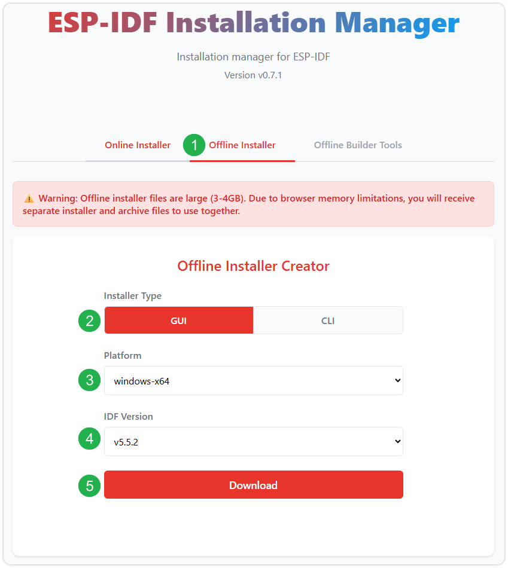

确认选择无误后，点击下载按钮。浏览器将自动同时下载两个文件：一个是 **ESP-IDF 离线整合包(.zst)**，另一个是 **ESP-IDF 安装器(.exe)**。

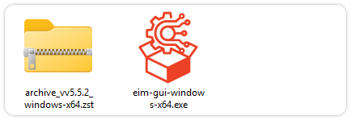

请耐心等待两个文件下载完成。

2. 下载完成后，双击运行 **ESP-IDF 安装器(eim-gui-windows-x64.exe)**。

启动后，可在右上角将界面语言切换为中文。

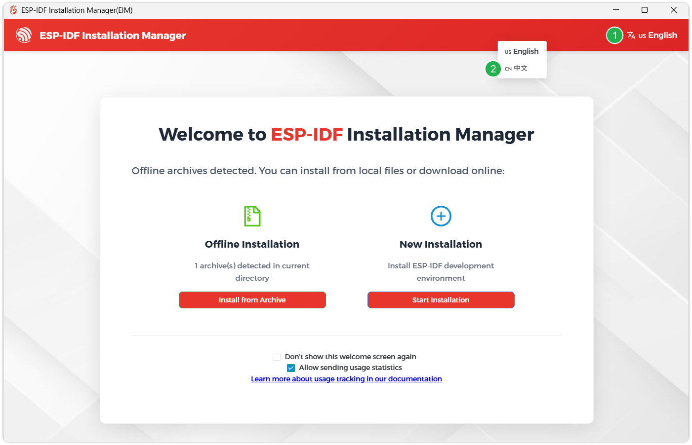

安装工具会自动检测同一目录下是否存在离线整合包。点击 **从存档安装**。

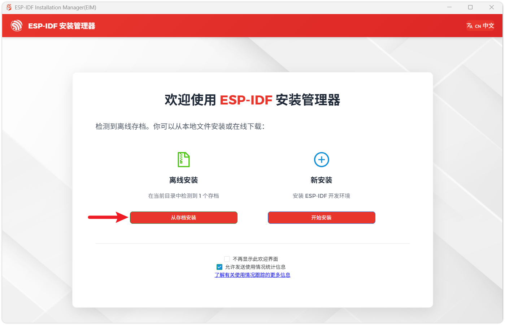

接下来，选择安装路径。建议使用默认路径；若需自定义，请确保路径中不包含中文或空格。确认无误后，点击 **开始安装**。

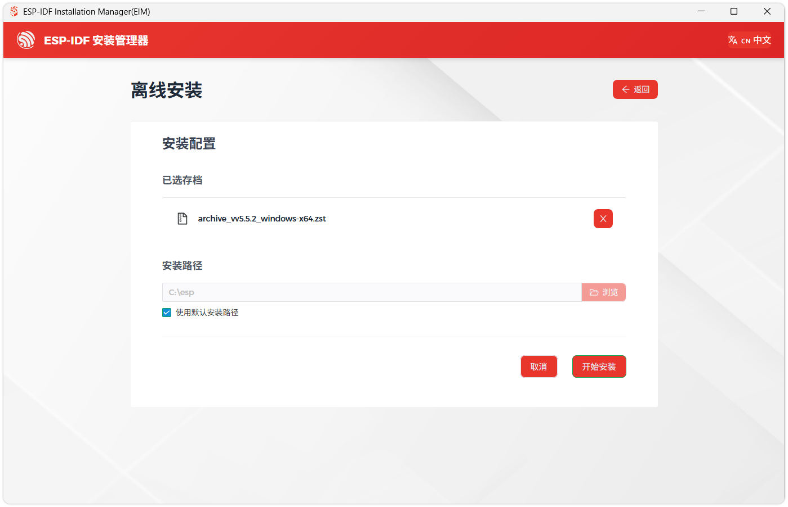

3. 当看到如下界面时，表示 ESP-IDF 已安装成功。

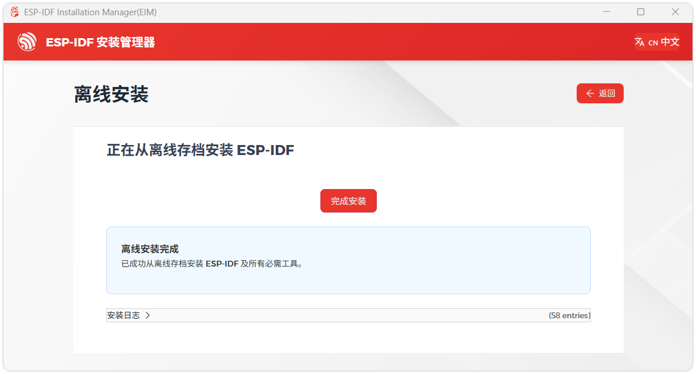

4. 建议同时安装驱动程序。点击 **完成安装**，然后点击 **安装驱动程序**。

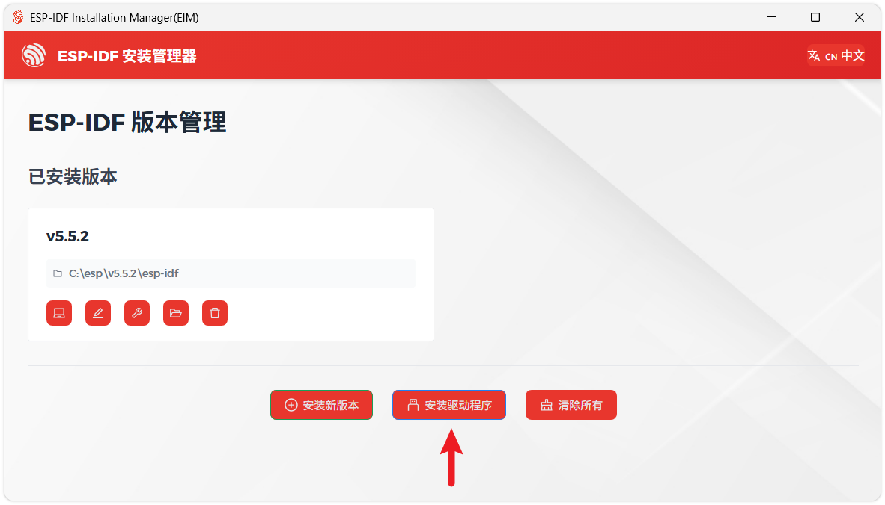

### 安装 Visual Studio Code 与 ESP-IDF 扩展

1. 下载并安装 [Visual Studio Code](https://code.visualstudio.com/)。

2. 安装时建议勾选 **通过 Code 打开操作添加到 Windows 资源管理器文件上下文菜单**,以便快速打开项目文件夹。

3. 在 VS Code 中,点击侧边活动栏中的 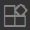 扩展图标(或使用快捷键 Ctrl + Shift + X)打开 **扩展** 视图。

4. 在搜索框中输入 **ESP-IDF**,找到 [ESP-IDF](https://marketplace.visualstudio.com/items?itemName=espressif.esp-idf-extension) 扩展并点击安装。

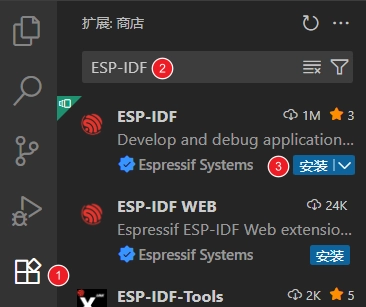

5. 当 **ESP-IDF 扩展版本 ≥ 2.0** 时,扩展会自动检测并识别上述步骤中安装的 ESP-IDF 环境,无需手动配置。

## 示例程序

ESP-IDF 示例程序位于 [示例程序包](https://files.waveshare.net/wiki/ESP32-C6-LCD-1.47/ESP32-C6-LCD-1.47-Demo.zip) 的 ESP-IDF 目录中

### ESP32-C6-LCD-1.47-Test

使用 VS Code，建议按以下步骤运行示例：

1. 打开 VS Code。

2. 选择 `File ---> Open Folder`，打开示例工程目录，例如：

```
ESP-IDF\ESP32-C6-LCD-1.47-Test
```

#### 程序说明

- 本示例演示了板载各个设备的功能，LCD 页面显示 SD Card，Flash Size，Wireless scan 参数及 CPU 利用率

#### 硬件连接

- 将 SD 卡装入开发板

- 将开发板接入电脑

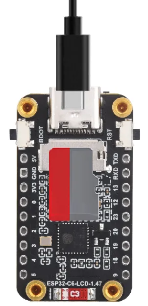

#### 代码分析

- setup

  - `Wireless_Init()` ：初始化无线通信模块

  - `Flash_Searching()` ：测试并打印设备的闪存大小信息

  - `RGB_Init()`：初始化 RGB 相关的功能

  - `RGB_Example()`：展示 RGB 的示例功能

  - `SD_Init()` ：初始化 SD 卡

  - `LCD_Init()`：初始化显示屏

  - `BK_Light(50)`：设置背光亮度为 50

  - `VGL_Init()`：初始化 LVGL 图形库

  - `Lvgl_Example1()`：调用特定的 LVGL 示例函数

- while(1)

  - `vTaskDelay(pdMS_TO_TICKS(10))`：短暂延迟，每 10 毫秒一次

  - `lv_timer_handler()`： LVGL 的定时器处理函数，用于处理与时间相关的事件和动画等

#### 代码烧录

- 选择开发板型号 ESP32C6 与端口

- UART 下载

- 烧录代码

#### 运行效果

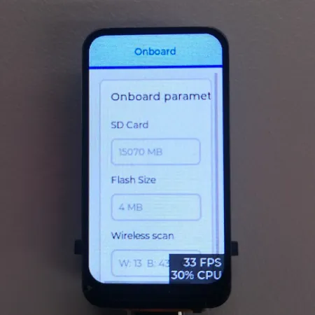
