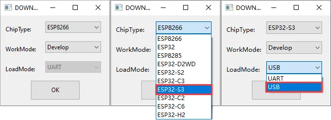
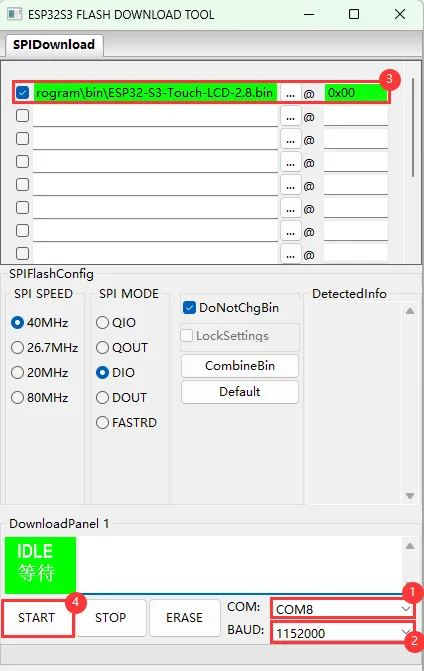
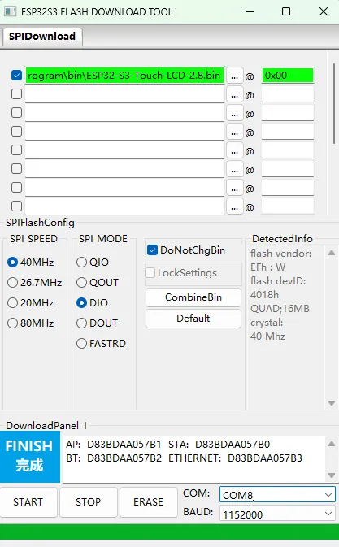
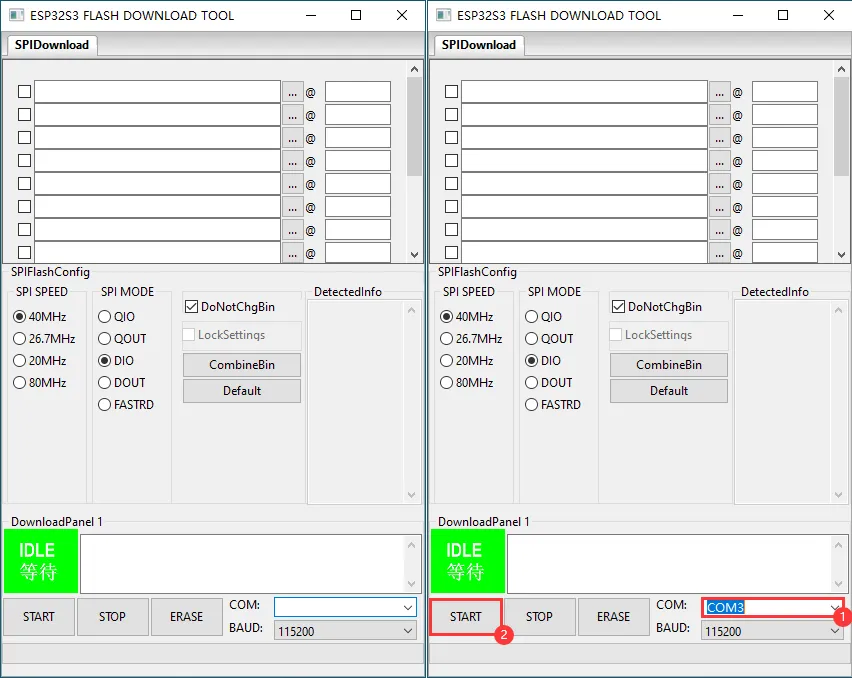
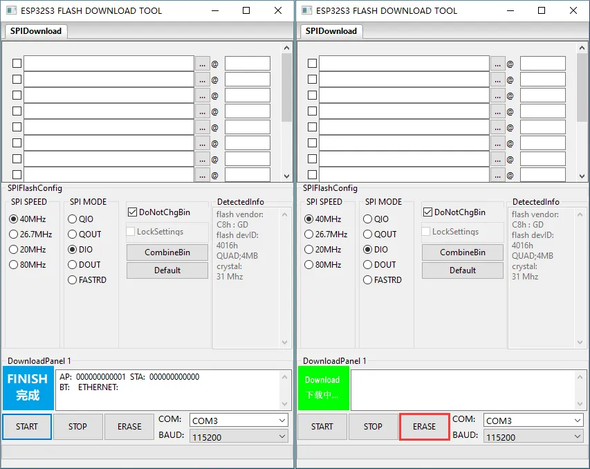

<!-- 来源：https://docs.waveshare.net/ESP32-C6-LCD-1.47/Firmware-Flashing/ 抓取日期：2026-11-18。内容版权归微雪电子（Waveshare）所有，此处仅为本地开发参考资料。 -->

# ESP32-C6-LCD-1.47 Flash 固件的烧录与擦除

当前产品提供了测试固件，可通过直接烧录测试固件来验证板载设备功能是否正常。

- 固件下载：[ESP32-C6-LCD-1.47 示例程序](https://files.waveshare.net/wiki/ESP32-C6-LCD-1.47/ESP32-C6-LCD-1.47-Demo.zip)，bin 文件位于代码资料中的 `Firmware` 目录下

- 烧录地址：`0x00`

**Flash 固件的烧录**

以下步骤适用于烧录本页提供的固件。

- 下载并解压乐鑫官方烧录工具 Flash Download Tool（[下载地址](https://dl.espressif.com/public/flash_download_tool.zip)）

- 运行 Flash Download Tool，根据开发板的主控芯片与下载接口选择对应选项。下图以 ESP32-S3 与 USB 为例，实际选项以产品硬件设计为准

- 参数设置

  - 选择与开发板所对应的 COM 口

  - 选择 BAUD 为最高的 1152000

  - 点击该行的“...”按钮，选择微雪提供的 bin 文件，并在其右侧手动填写本页上方给出的烧录地址（比如 `0x00`），同时勾选该行最左侧的复选框

  - 点击 **START** 开始烧录

- 等待烧录完成（烧录过程需要一定时间，请耐心等待）

- 按下复位键，观察运行现象

> **提示**
>
> 若出现一直处于“等待上电同步中”的情况，需按住“boot”重新上电，进下载模式即可解决

**Flash 固件的擦除**

> **提示**
>
> 点击 **ERASE** 即可擦除整片 flash。若擦除失败或设备无响应，请按住 **BOOT** 重新上电进入下载模式后重试。

- 下载并解压乐鑫官方烧录工具 Flash Download Tool（[下载地址](https://dl.espressif.com/public/flash_download_tool.zip)）

- 运行 Flash Download Tool，根据开发板的主控芯片与下载接口选择对应选项。下图以 ESP32-S3 与 USB 为例，实际选项以产品硬件设计为准

- 选择设备对应的 COM 口，**不选择任何 bin 文件**，点击 **START**

- 等待上述操作完成后，点击 **ERASE** 进行擦除

- 等待擦除完成

