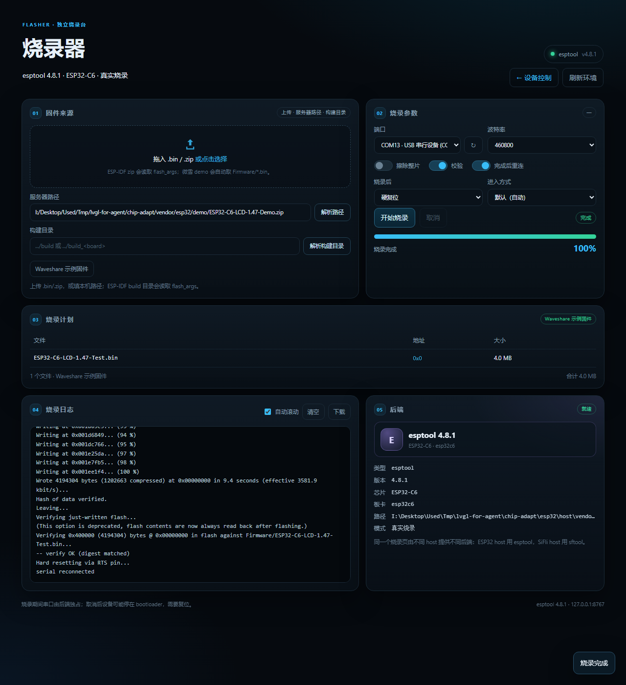
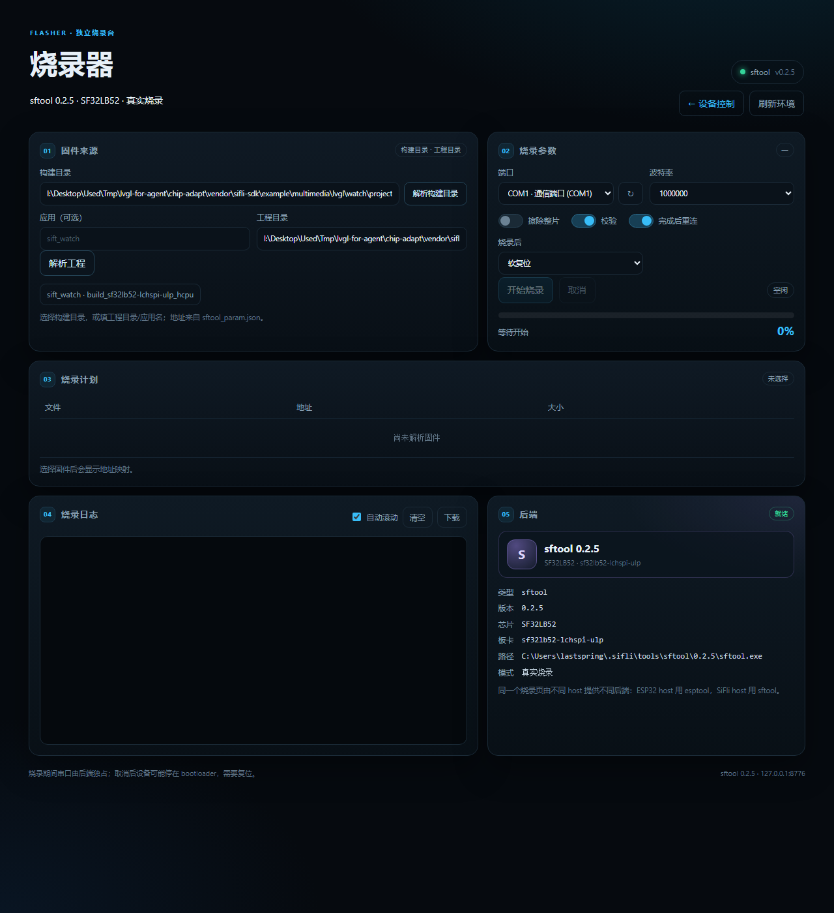

# 共享 host 层与烧录器（多后端）

`chip-adapt/host/` 提供两个 host 共用的基础设施，以及一套独立烧录网页。

| 模块 | 作用 |
| --- | --- |
| `jobs.py` | `Job` / `JobManager`，构建与烧录任务、事件和 SSE 快照 |
| `http_layer.py` | JSON body、SSE writer、来源校验、静态文件与错误状态映射 |
| `timeutil.py` | 统一 ISO 时间戳 |
| `flasher_web.py` + `flash_web/` | 共享烧录页、能力渲染和计划缓存 |

同一个烧录页由不同 host 提供时，使用该 host 自己的烧录后端：

| host | 页面 | 后端 | 串口/协议 | 默认波特率 |
| --- | --- | --- | --- | --- |
| ESP32-C6 | `http://127.0.0.1:8767/flash/` | `esptool` | ROM bootloader / USB Serial-JTAG / BLE NUS | 460800 |
| SiFli 黄山派 | `http://127.0.0.1:8766/flash/` | `sftool` | SF32 UART | 1000000 |

这里共享 **host 基础模块 + 烧录前端 + HTTP 契约 + 计划缓存**，不共享板级后端。ESP32
仍由 `chip-adapt/esp32/host/flash/flash_control.py` 解析固件并调用 esptool；SiFli 仍由
`chip-adapt/sifli/host/build_flash.py` 读取 `sftool_param.json` 并调用 sftool。

烧录页不是设备控制页里的 tab：ESP32 主页面左侧「烧录器」和 SiFli 标签栏「烧录器」
都会新开 `/flash/`。旧 ESP32 `?view=flash` 会跳转到该页。

## 快速开始

### ESP32-C6

```bash
# 首次：把 esptool 装到 host/vendor/esptool/（不进 Git）
powershell -NoProfile -ExecutionPolicy Bypass \
  -File chip-adapt/esp32/host/scripts/bootstrap.ps1

# 真机：自动选 USB JTAG/CH340 端口；也可以显式 --port COM13
python -I chip-adapt/esp32/host/host.py serve --port COM13 --baud 115200 --open

# 无板演示：fake 后端不碰串口、不调用 esptool
python -I chip-adapt/esp32/host/host.py serve --fake --open
```

打开 `http://127.0.0.1:8767/flash/`。页面顶部会显示 `esptool 4.8.1 · ESP32-C6 ·
真实烧录`（fake 模式显示「模拟烧录」）。

### SiFli 黄山派

```bash
# 启动串口 + 网页；sftool/工具链按 chip-adapt/vendor/README.md 安装
python -I chip-adapt/sifli/host/server.py --open
```

打开 `http://127.0.0.1:8766/flash/`，顶部显示 `sftool 0.2.5 · SF32LB52 · 真实烧录`。
旧页面 `http://127.0.0.1:8766/` 仍是终端优先的 SiFli UI，标签栏「烧录器」进入共享页。

## 界面

同一套页面、两个后端。左：ESP32-C6 真机烧录完成（`COM13`，4 MB demo，verify OK）；
右：SiFli host 的 `/flash/`，后端卡显示 `sftool 0.2.5`。

| ESP32-C6 · esptool | SiFli · sftool |
| --- | --- |
|  |  |

## 页面怎么用

1. **固件来源**：按当前后端显示入口（见下）。ESP32 可拖入 `.bin/.zip` 或填服务器
   路径/构建目录；SiFli 填构建目录，或工程目录 + 应用名。
2. **解析**：页面调用 `/api/flash/plan`，显示文件、地址、大小和来源标签。地址为
   `0x...`；SiFli 的地址来自 `sftool_param.json`。
3. **烧录参数**：端口、波特率、擦除整片、校验、烧录后动作、进入方式（仅 ESP32）、
   完成后重连。端口默认优先 USB JTAG / USB 串行 / CH340 / CP210x；没把握时显示
   「选择串口」，不会默认拿 COM1 开烧。
4. **开始烧录**：host 释放串口，esptool/sftool 独占 COM 口；进度条、百分比和日志
   来自任务 SSE。可取消；取消/失败会结束工具进程树。
5. **后端卡**：显示当前工具、版本、路径、芯片/板卡和「真实/模拟」模式，这就是同一
   套页面接不同后端的对照展示。

## 固件来源

### ESP32：`.bin` / `.zip` / ESP-IDF build 目录

- **上传**：`.bin` 或 `.zip`，上限 128 MiB；只写入 host 的 `.cache/flash/`，保留最近
  10 份。
- **服务器路径**：本机 `.bin`、`.zip`、build 目录或文件列表。
- **ESP-IDF build 目录**：优先 `flash_args`，其次 `flasher_args.json`，读取
  `flash_mode/freq/size` 与地址映射。
- **ZIP**：只读 central directory，只解压被引用的 BIN，不展开整个目录。
  - 有 `flash_args` / `flasher_args.json`：按其中地址解压；
  - 否则取唯一的 `Firmware/*.bin`（微雪 demo 常见布局）→ `0x0`；
  - 否则取 zip 内唯一 `.bin` → `0x0`；
  - 多个候选会返回 `ambiguous_images`，需要显式指定。
- **单个 BIN**：默认地址 `0x0`，可用 `--address`/`address` 覆盖。
- ZIP 解压会拒绝绝对路径、`..`、符号链接和加密项，并限制解压总量。

### SiFli：构建目录 / `sftool_param.json`

- 优先使用构建目录；目录里必须有 `sftool_param.json`。
- 也可以填工程目录（含 `SConstruct`）或应用名；host 会在 `exports_root/<app>/project`
  与 `build_<board>*/` 下查找。应用名存在时会优先于过期的工程目录。
- 只解析 `write_flash.files`，不启动 sftool；地址和大小直接显示在计划表。
- 共享页不提供上传 ZIP；SiFli 的官方 Web Flasher 流程仍走 `/tools/sftool/` 和
  `/api/flasher/prepare`。

## 串口、并发与取消

- 烧录开始前 host 调用 `broker.detach_for_flash()`；结束后只有在原来串口是打开的、
  `reconnect=true` 且不是 `no_reset` 时才重连。ESP32 会重试 8 次 × 0.5 s。
- 同一时间只允许一个烧录 job。第二个 `/api/flash/start` 返回 409 `flash_busy`；
  ESP32 的 `/api/flash`、SiFli 的 `/api/flash` 也共用同一把 gate。
- 取消会结束烧录工具进程：ESP32 结束 esptool 进程树，SiFli 终止 sftool；设备可能停在
  bootloader，需要复位后重试。
- **不要**在烧录期间用 `idf.py flash`、sftool-gui 或其它工具占用同一个 COM 口。

## HTTP 契约

| 方法 | 路径 | 说明 |
| --- | --- | --- |
| `GET` | `/flash/` | 独立烧录页；`/flash/<asset>` 是静态资源 |
| `GET` | `/api/flash/env` | 后端元数据 + 能力（见下） |
| `POST` | `/api/flash/upload?name=...` | ESP32 专用；原始字节上传，返回 `token` |
| `POST` | `/api/flash/plan` | `{token\|path\|build_dir\|files}`（ESP32）或 `{build_dir\|project_dir\|app}`（SiFli） |
| `POST` | `/api/flash/start` | `{plan_id, port?, baud?, erase_all?, verify?, after?, before?, reconnect?}` → 202 `job_id` |
| `GET` | `/api/jobs/<id>?since=N` | 任务快照；后端无关 |
| `GET` | `/api/jobs/<id>/stream?since=N` | SSE 增量帧，终态 `event: done` |
| `POST` | `/api/jobs/<id>/cancel` | 取消任务 |

ESP32 host 还保留旧的 `POST /api/flash`；新页面优先走 `/api/flash/start`。

`GET /api/flash/env` 的关键字段：

```json
{
  "backend": {
    "kind": "esptool | sftool",
    "name": "esptool",
    "version": "4.8.1",
    "label": "C:\\...\\python.exe -m esptool",
    "found": true,
    "chip": "ESP32-C6",
    "board": "esp32c6",
    "detail": "esptool 4.8.1 · ..."
  },
  "fake": false,
  "sources": ["upload", "path", "build_dir"],
  "baud_rates": [115200, 230400, 460800, 921600],
  "options": {
    "verify": true,
    "verify_supported": true,
    "erase_all": true,
    "after": ["hard_reset", "soft_reset", "no_reset"],
    "before": ["default_reset", "usb_reset"],
    "reconnect": true
  },
  "defaults": {"port": "COM13", "baud": 460800},
  "suggestions": [{"label": "...", "path": "..."}],
  "hint": ""
}
```

- `sources` 决定页面显示哪些固件入口：ESP32 是 `upload/path/build_dir`；SiFli 是
  `build_dir/project`。
- `options.before` 为空时页面隐藏「进入方式」。
- `verify_supported=false` 时页面禁用校验开关（esptool 5.x 始终校验）。
- `defaults.port` 优先当前打开的串口，其次 USB/JTAG/CH340/CP210x；都没有时为空。
- 计划只存在内存：10 分钟过期，最多 20 份；过期后重新解析。

## 新增后端

1. 在 host 的 `GET /api/flash/env` 里返回统一的 `backend` / `sources` / `options`。
2. `POST /api/flash/plan` 返回 `{plan_id, entries:[{name,address,size}], chip?, memory?, notes?}`，
   并把完整计划放进 `flasher_web.PlanStore`。
3. `POST /api/flash/start` 按 `plan_id` 取计划、创建 `jobs` 任务，串口释放/重连由该
   host 自己负责。
4. 页面不用改：新后端会自动显示在「后端」卡里，来源表单由 `sources` 驱动。

## 常见问题

| 现象 | 处理 |
| --- | --- |
| `/flash/` 打不开 / 404 | 对应 host 没启动，或端口不是 8767/8766 |
| `esptool not found` | 跑 `chip-adapt/esp32/host/scripts/bootstrap.ps1`，或设 `ESPTOOL_BIN` |
| `sftool not found` | 安装 SiFli 工具链，或设 `SFTOOL_BIN` / `config.json` 的 `sftool` |
| 端口列表没有开发板 | 装 USB 驱动/换线；页面会显示「选择串口」，不要乱选 COM1 |
| `Failed to connect ... No serial data received` | ESP32 先试 `--before usb_reset`；仍失败按住 BOOT 再上电 |
| `flash_busy` | 已有一个烧录 job；等它结束或先取消 |
| `plan_not_found` | 计划过期（10 分钟）；重新解析固件 |
| `upload_too_large` | ESP32 上传上限 128 MiB |
| 5.x 没有「校验」开关 | esptool 5.x 始终校验，页面按版本禁用该选项 |
| 取消后设备没反应 | 可能停在 bootloader；复位/重新上电再试 |

## 实机记录（2026-11-18）

- 设备：ESP32-C6FH4，USB JTAG/serial 在 `COM13`；`esptool flash_id` 报 **8 MB Flash**
  （官方文档写 4 MB，微雪 demo 也打印 `Flash size: 8 MB`，做分区表前按实际批次确认）。
- 固件：微雪 demo `Firmware/ESP32-C6-LCD-1.47-Test.bin`，4 MB @ `0x0`。
- 网页 `/flash/` 自动选中 `COM13`，烧录约 14.7 s，进度 **100%**；esptool 输出
  `Hash of data verified` 与 `-- verify OK (digest matched)`。
- 烧录时串口已打开的场景会先释放、结束后日志出现 `serial reconnected`；串口读取确认
  demo 正在跑 BLE/Wi-Fi/RAM 测试。
- 截图：[`docs/esp32-real-flash.png`](docs/esp32-real-flash.png)（完成态）、
  [`docs/sifli-flash-page.png`](docs/sifli-flash-page.png)（sftool 后端）。
- SiFli 的 sftool 后端已接好，但当前机器只检测到 ESP32 板卡，没有 SiFli CH340 串口，
  尚未做真机烧录。

## 测试

```bash
python -I chip-adapt/esp32/host/tests/run_tests.py
python -I chip-adapt/sifli/host/tests/run_tests.py
```

共享层测试在两边都有：静态路径穿越、`PlanStore`、`/flash/` 渲染、env/plan 形状、
端口偏好；ESP32 的 fake 后端和 SiFli 的临时 `sftool_param.json` 都不需要板子。

2026-11-19 记录：ESP32 host 85 个测试、SiFli host 99 个测试通过；`scripts/lint.py`
0 findings。

## 目录

```text
chip-adapt/host/
  jobs.py              Job / JobManager，构建与烧录任务
  http_layer.py        JSON/SSE/静态文件/来源校验
  timeutil.py          ISO 时间戳
  flasher_web.py       安全静态路径、MIME、PlanStore（10 分钟 / 20 份）
  flash_web/
    index.html         独立烧录页（不是主 UI 的 tab）
    flasher.css
    flasher.js         能力渲染、上传、计划、SSE 任务、后端展示
```
